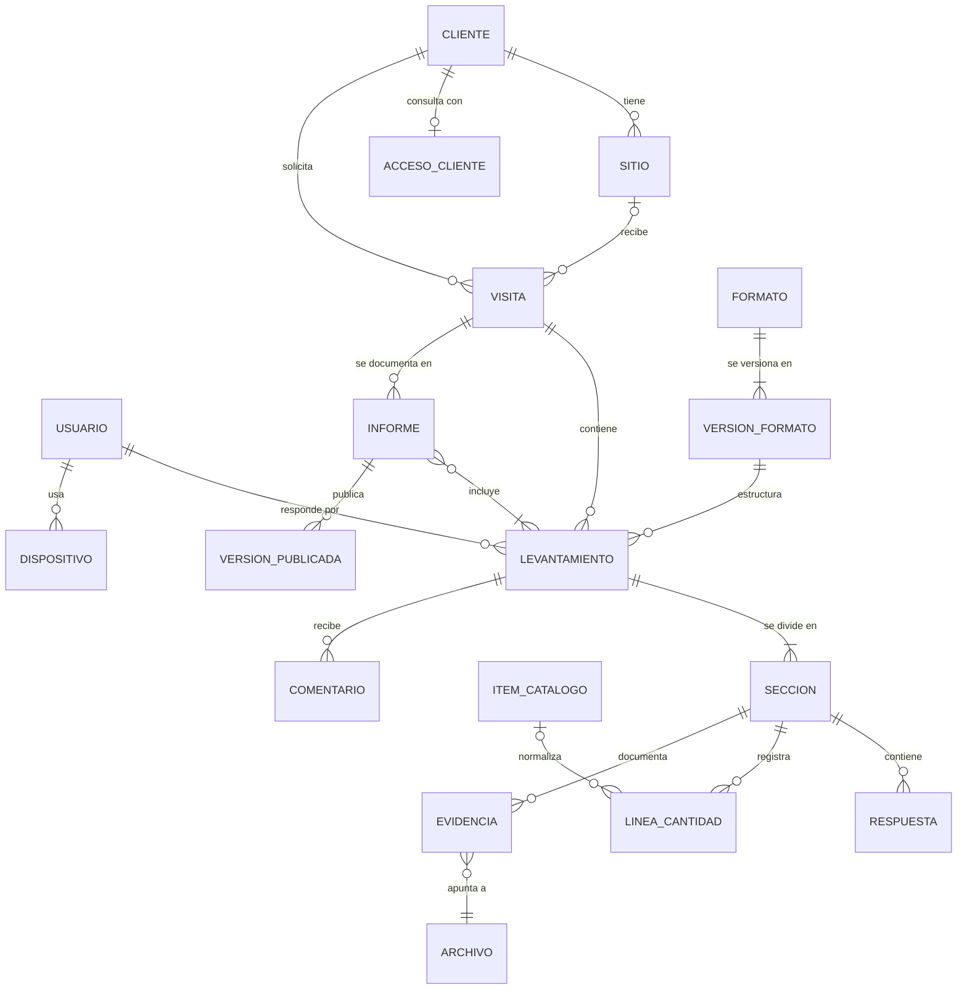

# Modelo de dominio

Método: patrones estratégicos y tácticos de Domain-Driven Design, adaptados a un proyecto de una persona.

Los diagramas de estados vigentes (levantamiento, visita, envíos al cliente y versiones) y dónde vive cada transición en el código están en [`03-como-funciona.md`](03-como-funciona.md). Si este documento y el código no coinciden, manda el código y se corrigen los dos.

---

## 1. Lenguaje común

| Término | Definición | Qué **no** es |
|---|---|---|
| **Organización** | Empresa que usa el sistema. Hoy solo TEINS | No es el cliente de TEINS |
| **Cliente** | Empresa o persona a la que TEINS presta servicio | No es un usuario interno |
| **Sitio** | Lugar físico de un cliente donde se interviene | No es la dirección de facturación |
| **Visita** | Desplazamiento a un sitio con un motivo (cotización, mantenimiento, modificación) | No es el documento que se llena |
| **Levantamiento** | Información capturada por **un** técnico con **un** formato durante una visita | No es el informe |
| **Formato** | Plantilla de un tipo de servicio | No es un levantamiento lleno |
| **Versión de formato** | Definición congelada de un formato | Nunca cambia después de publicarse |
| **Sección** | Parte de un levantamiento; puede repetirse (Piso 1, Piso 2…) | No es una hoja de papel |
| **Respuesta** | Valor de un campo dentro de una sección | — |
| **Medida** | Número acompañado siempre de una unidad del catálogo de unidades | Nunca un número suelto |
| **Evidencia** | Foto o boceto asociado a una sección o campo | No es un plano de oficina |
| **Boceto** | Dibujo a mano alzada hecho en campo sobre cuadrícula | No es un plano de ingeniería |
| **Línea de cantidad** | Material o trabajo con descripción, cantidad, unidad y observación | No incluye precio |
| **Ítem de catálogo** | Material estandarizado de la lista de TEINS | — |
| **Comentario** | Nota de oficina dirigida al técnico; abre una conversación que el técnico responde desde el teléfono (ADR-0040) | No modifica datos; se cierra al marcar revisado |
| **Informe** | Composición de oficina a partir de levantamientos revisados, con planos y textos propios | No es el PDF |
| **Versión publicada** | Copia congelada de un informe, con su PDF, entregada al cliente | Nunca se edita |
| **Acceso de cliente** | Credencial (QR y clave) con la que un cliente consulta sus informes | No es un usuario interno |
| **Plano** | Documento técnico elaborado en oficina con sus propias herramientas | No se dibuja en el sistema |

**Distinción fundamental:** levantamiento ≠ informe. El levantamiento guarda hechos de campo; el informe es una composición editorial de oficina.

---

## 2. Módulos

| Módulo | Contenido | Tipo | Rigor |
|---|---|---|---|
| Levantamientos | Captura, secciones, respuestas, evidencias, cantidades, revisión | **Núcleo** | Hexagonal |
| Formatos y catálogos | Formatos versionados, tipos de servicio, ítems, unidades | **Núcleo** | Hexagonal |
| Visitas | Visitas y programación | Soporte | Capas simples |
| Clientes | Clientes y sitios | Soporte | Capas simples |
| Informes | Composición, publicación, versiones, PDF | Soporte | Capas simples |
| Cotizaciones | Cotización desde las cantidades revisadas, lista de precios con historia, versiones y PDF (ADR-0029) | Soporte | Capas simples |
| Envíos | Envío de informes y cotizaciones a los contactos del cliente por correo y WhatsApp, con su estado (ADR-0028, ADR-0034) | Soporte | Capas simples |
| Símbolos | Biblioteca de símbolos del croquis que publica la organización (ADR-0027) | Soporte | Capas simples |
| Portal del cliente | Acceso de cliente, consulta, registro de descargas | Soporte | Capas simples, seguridad reforzada |
| Identidad y acceso | Usuarios, roles, dispositivos, revocación | Genérico | Adaptador sobre solución existente |
| Trazabilidad | Registro de cambios | Genérico transversal | Desde el día uno |
| Archivos | Fotos, bocetos, planos | Genérico | Adaptador sobre almacenamiento de objetos |
| Sincronización y cambios | Subida idempotente y bajada por registro de cambios con punto de control y época (ADR-0003, ADR-0038) | Genérico transversal | Capas simples |
| Avisos | Avisos push a técnicos y oficina (ADR-0023) | Genérico | Adaptador sobre Web Push |
| Mantenimiento | Tarea periódica del worker: recupera trabajos a medias y poda (ADR-0043, ADR-0044) | Genérico transversal | Capas simples |
| *Estadísticas, Integraciones* | *Futuro* | | Solo la costura |

---

## 3. Entidades y relaciones

Todas las entidades llevan identificador de organización (omitido en el diagrama).

**Decisión clave:** una visita contiene varios levantamientos, y cada levantamiento tiene exactamente un técnico responsable y un formato. Resuelve varios técnicos por visita (P4) sin edición simultánea, visitas con varios servicios e informes consolidados.

---

## 4. Agregados

| Agregado | Contiene | Quién lo modifica | ¿Viaja al dispositivo? |
|---|---|---|---|
| **Levantamiento** | Secciones, respuestas, líneas de cantidad, referencias a evidencias | Técnico en borrador; oficina después | Sube al enviar; su estado baja |
| **Archivo** | Binario inmutable con huella digital | Quien lo crea | Sube |
| **Comentario** | Texto, autor, fecha, referencia al campo y, si es respuesta, a qué comentario responde y de qué lado (ADR-0040) | Lo abre oficina; el técnico responde | Baja con sus respuestas; las del técnico suben |
| **Visita** | Cliente, sitio, motivo, canal de origen, técnicos asignados, fecha y horario (ADR-0037); se cierra al día siguiente de atendida (ADR-0041) | Oficina, supervisor | Baja; atendida, sale del teléfono |
| **Formato** | Nombre, tipo de servicio, versión vigente | Administrador | No |
| **Versión de formato** | Definición completa (ADR-0006) | Nadie tras publicarse | Baja |
| **Ítem de catálogo** | Código, descripción, unidad por defecto, activo | Oficina, administrador | Baja |
| **Cliente** | Datos del cliente y sus sitios | Oficina | Lo necesario, baja |
| **Informe** | Levantamientos incluidos, planos, textos, orden y qué sale de cada uno (ADR-0039) | Oficina | No |
| **Versión publicada** | Copia congelada de datos, planos y PDF | Nadie; solo puede retirarse | No |
| **Acceso de cliente** | Credencial, QR, estado, registro de descargas | Administrador | No |
| **Usuario** | Nombre, identificación, roles, estado | Administrador | Solo el propio |
| **Dispositivo** | Usuario, última sincronización, orden de borrado | Sistema, administrador | Sí |

Decisiones incluidas:

1. **Evidencias separadas de sus archivos:** el levantamiento guarda la referencia; el binario viaja aparte.
2. **Identificadores generados en el dispositivo** (UUID v7): sin identificadores temporales; los reintentos no duplican.
3. **Solo el módulo de captura viaja al dispositivo.**

---

## 5. Ciclos de vida

### Levantamiento

| Estado | Quién edita | Entrada | Salida |
|---|---|---|---|
| Borrador | Solo el técnico responsable | Al crearlo | Enviar → Enviado |
| Enviado | Nadie | El técnico lo envía | Un revisor lo toma → En revisión |
| En revisión | **Solo el revisor que lo tomó** | Toma de revisión | Marcar revisado → Revisado |
| Revisado | Nadie | Fin de la revisión | Final; se incluye en informes |

En el código, `EstadoLevantamiento` es `borrador | enviado | en_revision | revisado`. No hay estado para anular un levantamiento.

- **Estado de negocio ≠ estado de sincronización.** El estado del envío (`pendiente`, `enviando`, `recibido`, `error`, `requiere_sesion`, `requiere_actualizar`) vive solo en el dispositivo.
- **Toma de revisión (I-1):** un revisor toma el levantamiento y queda visible como responsable. Otro puede reasignarse la toma explícitamente, lo que queda registrado. Cada guardado lleva la versión que el usuario tenía abierta; si otro guardó antes, se rechaza (QA-25).
- **Revisado es final:** oficina solo corrige en En revisión, con la toma. Soltar a mano, reabrir un Revisado y devolverlo al técnico están en [ADR-0032](../adr/0032-soltar-reabrir-y-devolver-una-revision.md), que sigue aplazado.
- **Revisión sin responsable:** solo ocurre al desactivar al revisor. Sus levantamientos en revisión siguen En revisión, sin revisor, y cualquiera de oficina los puede tomar; no vuelven a Enviado. Oficina no tiene una acción «Soltar».
- **Llegada completa:** el servidor solo registra un envío cuando llegaron todos sus archivos con huellas correctas.
- **Un envío que oficina nunca recibió vuelve a Borrador (ADR-0045):** si el servidor lo rechaza para siempre, en el teléfono queda «No se pudo enviar» y el técnico puede volverlo a borrador para corregirlo. Como oficina no lo tiene, sigue habiendo un solo editor. No aplica si la visita ya tiene otro borrador, ni a lo que oficina ya recibió.
- **Un envío en cola no se cancela en el teléfono:** solo con el envío en `error` el técnico puede volverlo a borrador (ADR-0045) o descartarlo a la papelera ([ADR-0046](../adr/0046-descartar-un-envio-en-error.md), que amplía el [ADR-0035](../adr/0035-archivar-clientes-comentarios-y-borradores.md)). Cancelar envíos ([ADR-0034](../adr/0034-cancelar-envios-y-retirar-cotizaciones.md)) es para los envíos de oficina al cliente.

### Informe

| Estado | Descripción |
|---|---|
| Borrador | Oficina compone |
| Publicado (versión n) | Oficina aprueba y publica (P24); copia congelada con PDF |
| Nueva versión | Se edita el borrador y se publica n+1; n se conserva (P25) |
| Versión retirada | El administrador la saca del portal; queda registrado |

La versión publicada es una **copia**, no una referencia. Al retirar una versión, sus envíos al cliente que no han salido quedan cancelados y no se pueden reanudar ([ADR-0047](../adr/0047-retirar-una-version-cancela-sus-envios.md)).

### Visita

Su avance se **deduce** de sus levantamientos e informes. Lo explícito son tres marcas con fecha: *Cancelada* (`canceladaEn`, la pone oficina), *Terminada* (`terminadaEn`, desde la iteración 31: un técnico la termina desde su teléfono, ADR-0037) y *Cerrada* (`cerradaEn`: atendida y de un día anterior, sale de los teléfonos, ADR-0041; reprogramarla a otro día u hora la reabre, ADR-0042). Su horario puede ser todo el día, de una hora a otra, o desde una hora hasta que la terminen; mientras tanto el técnico está ocupado y no se le programa otra visita que se cruce.

---

## 6. Reglas del negocio

1. Un levantamiento tiene exactamente un técnico responsable y una versión de formato; ninguno cambia tras crearlo.
2. En borrador, solo el técnico responsable edita.
3. Para enviar, todo campo obligatorio tiene valor o está marcado "no se pudo obtener" con motivo.
4. Tras el envío, el técnico no edita; la única excepción es un envío que oficina nunca recibió (en `error`), que vuelve a borrador (ADR-0045). Cada cambio de oficina se registra con autor, fecha, campo, valor anterior y nuevo.
5. Una medida siempre lleva una unidad permitida para su campo.
6. Una línea de cantidad requiere descripción, cantidad mayor que cero y unidad. El técnico puede elegir el ítem del catálogo al capturarla; oficina confirma, cambia o completa el vínculo (ADR-0025).
7. Las líneas de cantidad nunca guardan precio.
8. Una versión de formato publicada no se modifica; los levantamientos conservan la suya.
9. Un informe solo incluye levantamientos de la misma visita en estado Revisado.
10. Publicar crea una versión inmutable con número consecutivo; el cliente ve la vigente.
11. Una versión publicada nunca se borra; puede retirarse con registro.
12. Un acceso de cliente solo muestra versiones vigentes de su cliente.
13. Un usuario desactivado no autentica; sus dispositivos se marcan para borrado local; su autoría se conserva.
14. Nada del negocio se borra físicamente en el servidor: se cancela (visitas, envíos), se archiva (clientes, sitios) o se retira (versiones, comentarios). En borrador, los borrados del técnico viajan como **marcas de borrado** (I-3).
15. Cada dato pertenece a una organización; ninguna relación cruza organizaciones.
16. **Doble hora (I-2):** todo registro guarda la hora del dispositivo (declarada) y la hora del servidor (oficial). La oficial es la del servidor.
17. **Reasignación (I-4):** reasignar una visita no invalida levantamientos ya iniciados; oficina decide cuáles incluir en el informe.
18. **Minimización (I-20):** las versiones publicadas incluyen los datos personales mínimos necesarios (por ejemplo, cargo en lugar de teléfono del contacto).
19. **Las fotos no conservan metadatos** de ubicación ni del dispositivo (QA-23).

---

## 7. Eventos de dominio

Los eventos se guardan en el registro de auditoría (`auditoria.registros`, [ADR-0008](../adr/0008-trazabilidad-e-integridad.md)) en la misma transacción del cambio, con el nombre que lleva el código (`TipoEvento` en `paquetes/servidor/src/modulos/auditoria/registrar.ts`). Las reacciones no se suscriben al evento: las hace la misma operación o un trabajo que ella encola.

Los principales:

| Evento | Reacción hoy | Reacción futura posible |
|---|---|---|
| `levantamiento_enviado` | Bandeja de oficina, aviso push a oficina | |
| `revision_tomada` | Visibilidad del responsable | |
| `revision_reasignada` | Otro revisor toma lo que alguien ya tenía; queda el anterior | |
| `revision_liberada` | Al desactivar al revisor, el levantamiento queda en revisión sin responsable | |
| `campo_corregido` | Trazabilidad | Estadísticas de errores frecuentes (P9) |
| `levantamiento_revisado` | Disponible para informes, aviso push al técnico | |
| `informe_publicado` | PDF, portal, envíos al cliente en cola | |
| `cotizacion_publicada` | PDF y envíos al cliente en cola (ADR-0029) | |
| `version_retirada` | Sale del portal; sus envíos que no han salido se cancelan (ADR-0047) | |
| `usuario_desactivado` | Cierra sus sesiones, ordena el borrado en sus dispositivos y suelta sus revisiones | |
| `acceso_cliente_regenerado` | Invalida el QR anterior y cierra las sesiones del portal | |

El resto, por agregado:

| Agregado | Eventos |
|---|---|
| Levantamiento | `levantamiento_creado`, `linea_vinculada`, `comentario_agregado`, `comentario_respondido`, `comentario_editado`, `comentario_retirado`, `comentario_restaurado` |
| Visita | `visita_creada`, `visita_reasignada`, `visita_reprogramada`, `visita_cancelada`, `visita_terminada` |
| Cliente | `cliente_creado`, `cliente_editado`, `cliente_archivado`, `cliente_recuperado`, `sitio_agregado`, `sitio_editado`, `sitio_archivado`, `sitio_recuperado`, `contacto_creado`, `contacto_editado`, `contacto_quitado` |
| Informe | `informe_enviado`, `envio_cancelado`, `envio_reanudado` |
| Cotización | `cotizacion_creada`, `cotizacion_enviada`, `envio_cancelado`, `envio_reanudado` |
| Ítem de catálogo | `item_catalogo_creado`, `item_catalogo_actualizado`, `precio_cambiado` |
| Usuario | `usuario_creado`, `usuario_reactivado`, `contrasena_restablecida`, `contrasena_cambiada`, `administrador_cambiado`, `segundo_factor_activado`, `segundo_factor_quitado`, `llave_de_acceso_creada`, `llave_de_acceso_quitada`, `borrado_local_confirmado` |
| Acceso de cliente | `acceso_cliente_creado`, `ingreso_portal`, `descarga_portal` |
| Organización | `inicio_de_sesion`, `catalogo_importado` |

Cerrar una visita atendida (ADR-0041) no deja evento: es una marca que pone el sistema al bajar.

---

## 8. Permisos preliminares

| Acción | Técnico | Oficina | Supervisor | Administrador | Cliente |
|---|---|---|---|---|---|
| Crear y programar visitas | — | Sí | Sí | — | — |
| Capturar y enviar levantamientos | Solo los propios | — | — | — | — |
| Tomar, revisar y corregir | — | Sí | ? | — | — |
| Comentar | — | Sí | ? | — | — |
| Componer y publicar informes | — | Sí (P24) | ? | — | — |
| Retirar una versión publicada | — | — | ? | Sí | — |
| Gestionar catálogo | — | Sí | — | Sí | — |
| Gestionar formatos | — | — | — | Sí | — |
| Gestionar usuarios y accesos de cliente | — | — | — | Sí | — |
| Consultar todo | — | Sí | Sí | Sí | — |
| Descargar sus informes | — | — | — | — | Sí |

"?" depende de la función del supervisor, pendiente de definir. Los roles son un conjunto asignable: definirlo no cambia el modelo.

---

## 9. Variantes según preguntas pendientes

| Pregunta | Supuesto actual | Si la respuesta es distinta |
|---|---|---|
| P4 | Un levantamiento por técnico | Solo un levantamiento compartido y editado a la vez rompería el diseño; se desaconseja |
| P5 | Sitio como entidad | Se vuelve opcional |
| P26 | Informe por visita | La regla 9 pasa a "mismo cliente"; el modelo no cambia |
| P2 | Oficina programa las visitas | Se agrega "visita no programada" creada sin conexión con cliente provisional |
| P10 | Formatos editados por administrador/desarrollador | Un editor visual se construye sobre el mismo modelo |

---

## 10. Fuera de alcance deliberado

Agenda avanzada · precios y presupuestos (solo la costura) · dibujo técnico de planos · edición simultánea de un levantamiento · devolución formal al técnico · ubicación GPS · verificación de autenticidad de informes · interfaz multiempresa.
