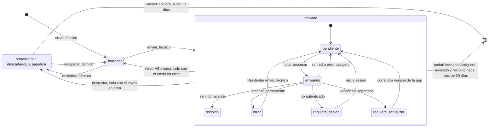
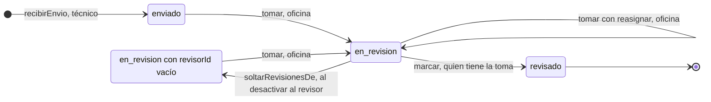
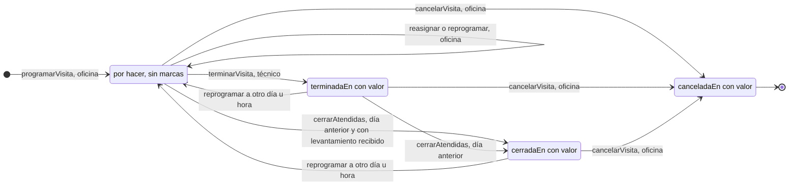
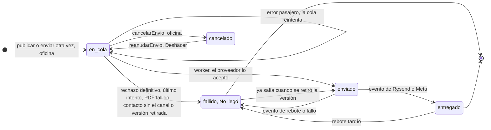
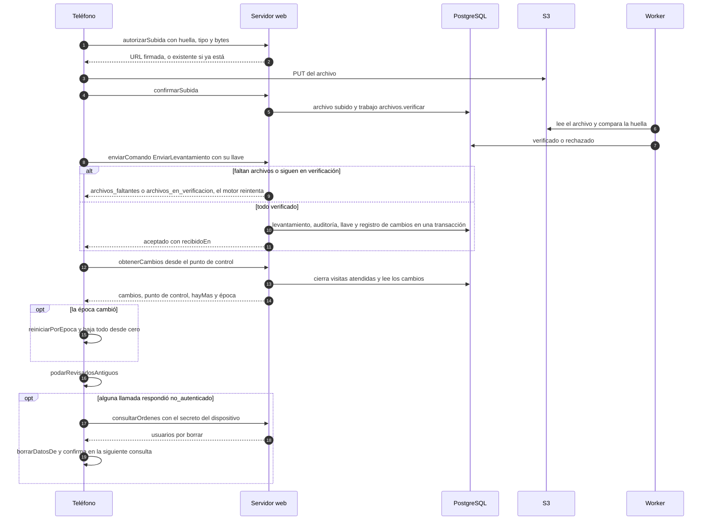
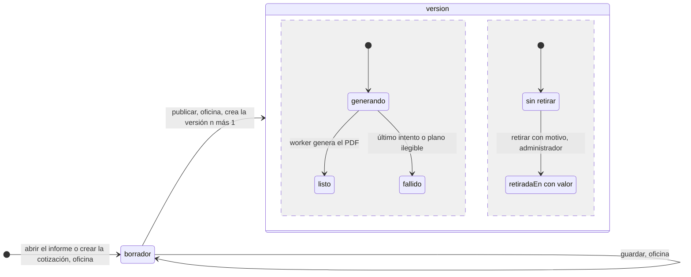
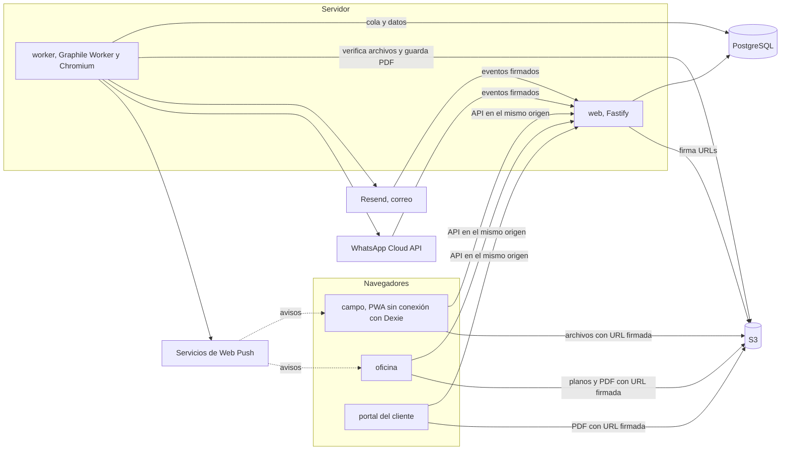
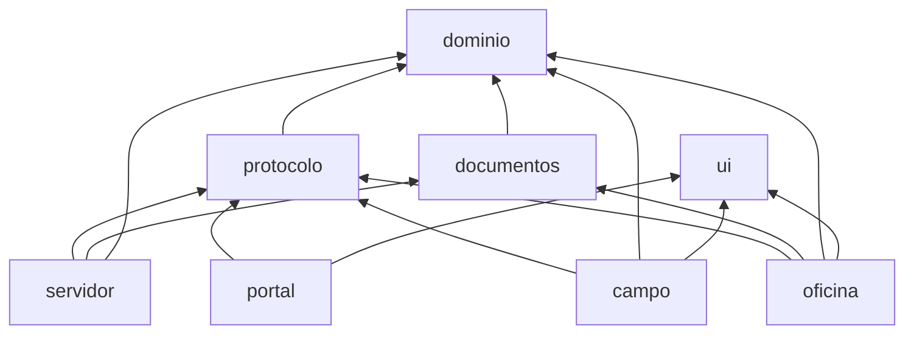

# Cómo funciona

Este documento muestra cómo se comporta el sistema hoy: los estados de cada cosa, quién los cambia y por dónde viajan los datos. Complementa a [`01-impulsores.md`](01-impulsores.md) (por qué) y a [`02-modelo-dominio.md`](02-modelo-dominio.md) (lenguaje común, agregados y reglas; ahí está el diagrama de entidades). Las decisiones están en los [ADR](../adr/README.md).

**Regla de mantenimiento:** un diagrama de este archivo se actualiza en el mismo commit que cambia el comportamiento que dibuja. Cada sección termina con "Si cambias esto, actualiza", que dice qué código y qué documentos revisar. Las referencias al código van como `ruta:símbolo` para que sobrevivan a los cambios de línea.

Los nombres de estados son los identificadores del código. Donde el estado no es una columna sino una marca (una fecha con valor), la etiqueta dice cuál.

---

## 1. Ciclo de vida del levantamiento

El levantamiento vive en dos lugares y cada uno tiene su propio estado. En el teléfono es un borrador que solo existe ahí hasta que el servidor lo recibe ([ADR-0003](../adr/0003-estrategia-de-sincronizacion.md)); por eso nada local se borra para resolver un problema (regla 5) y lo descartado pasa por una papelera. En el servidor nace ya enviado, y desde ahí solo edita quien tomó la revisión (regla 3). El estado de sincronización (`EstadoEnvio`) es distinto del estado de negocio y vive solo en el teléfono.

### 1a. En el teléfono

Lo que el diagrama no dibuja para no llenarlo de flechas:

- **Revocación** ([ADR-0022](../adr/0022-cifrado-local-en-campo.md), [ADR-0009](../adr/0009-identidad-y-acceso.md)): si el servidor ordena borrar a un usuario, `borrarDatosDe` destruye su clave y sus datos desde cualquier estado, también los borradores.
- **Época nueva** ([ADR-0038](../adr/0038-epoca-de-la-bajada.md)): `reiniciarPorEpoca` y la bajada completa quitan lo `recibido` que el servidor ya no conoce. Nunca tocan borradores ni lo que falta por enviar.
- **Estado de oficina:** el teléfono guarda aparte (`estadosServidor`) el estado que baja del servidor (`enviado`, `en_revision`, `revisado`) con los comentarios. El levantamiento local sigue en `enviado`.

| Transición | Quién | Dónde en el código | ADR |
|---|---|---|---|
| crear | Técnico | `paquetes/campo/src/datos/dexie.ts:crear` | 0004 |
| descartar | Técnico | `paquetes/campo/src/datos/dexie.ts:descartar` | 0035, 0045 |
| recuperar (vuelve suelto si la visita ya tiene otro borrador) | Técnico | `paquetes/campo/src/datos/dexie.ts:recuperar` | 0035 |
| vaciar la papelera, al abrir la app | Sistema | `paquetes/campo/src/datos/dexie.ts:vaciarPapelera`, `DIAS_EN_LA_PAPELERA` | 0035 |
| enviar: `borrador` → `enviado` y comando al outbox en una transacción | Técnico | `paquetes/campo/src/datos/dexie.ts:enviar`, `paquetes/dominio/src/estados.ts:enviarLevantamiento` | 0003, 0018 |
| `pendiente` → `enviando` → `recibido`, `error`, `requiere_sesion`, `requiere_actualizar` | Sistema | `paquetes/campo/src/sincronizacion/motor.ts:procesar` | 0003, 0015 |
| `enviando` interrumpido vuelve a `pendiente` | Sistema | `paquetes/campo/src/sincronizacion/almacen.ts:recuperarInterrumpidos` | 0003 |
| `requiere_sesion` → `pendiente` | Técnico, al iniciar sesión | `paquetes/campo/src/sesion/sesion.ts` (`almacen.reanudar`) | 0009 |
| `requiere_actualizar` → `pendiente` | Sistema | `paquetes/campo/src/sincronizacion/almacen.ts:reanudarTrasActualizar` | 0015 |
| Reintentar envío | Técnico | `paquetes/campo/src/datos/dexie.ts:reintentarEnvio` | 0003 |
| volver a borrador (sin estado del servidor; sale con la misma llave) | Técnico | `paquetes/campo/src/datos/dexie.ts:volverABorrador`, `paquetes/protocolo/src/llaves.ts:llaveDeEnvio` | 0045 |
| sale del teléfono a los 30 días de revisado y recibido | Sistema, tras cada bajada | `paquetes/campo/src/sincronizacion/almacen.ts:podarRevisadosAntiguos`, `DIAS_DE_RETENCION` | 0044 |
| borrado por revocación | Administrador, cumple el sistema | `paquetes/campo/src/sincronizacion/almacen.ts:borrarDatosDe` | 0009, 0022 |

### 1b. En el servidor

El servidor solo registra el envío cuando llegaron y se verificaron todos sus archivos (llegada completa), con la llave de idempotencia reservada en la misma transacción. `revisado` es final hoy: no hay soltar, reabrir ni devolver a mano ([ADR-0032](../adr/0032-soltar-reabrir-y-devolver-una-revision.md) sigue como propuesta aplazada). Corregir campos (`corregirCampos`) no cambia el estado; exige `en_revision`, ser quien tiene la toma y la versión vigente (QA-25).

| Transición | Quién | Dónde en el código | ADR |
|---|---|---|---|
| recibir el envío | Técnico (comando `EnviarLevantamiento`) | `paquetes/servidor/src/modulos/levantamientos/aplicacion/recibir-envio.ts:recibirEnvio` | 0003, 0007, 0008 |
| tomar | Oficina | `paquetes/servidor/src/modulos/levantamientos/aplicacion/revision.ts:tomar`, `paquetes/dominio/src/revision.ts:tomarRevision` | 0008 |
| tomar con `reasignar` (evento `revision_reasignada`) | Oficina | los mismos | 0008 |
| quedar sin responsable (evento `revision_liberada`) | Administrador, al desactivar | `paquetes/servidor/src/modulos/levantamientos/index.ts:soltarRevisionesDe` | 0033 |
| marcar revisado | Quien tiene la toma | `paquetes/servidor/src/modulos/levantamientos/aplicacion/revision.ts:marcar`, `paquetes/dominio/src/revision.ts:marcarRevisado` | 0008 |

**Si cambias esto, actualiza:** `paquetes/dominio/src/levantamiento.ts` (`EstadoLevantamiento`), `paquetes/dominio/src/revision.ts`, `paquetes/campo/src/datos/modelo.ts` (`EstadoEnvio`), `paquetes/campo/src/datos/dexie.ts`, `paquetes/campo/src/sincronizacion/motor.ts`, `paquetes/protocolo/src/operaciones.ts` (`EstadoLevantamiento`), `02-modelo-dominio.md` sección 5 y el ADR que corresponda.

---

## 2. Visita

La visita no tiene una columna de estado: su avance se deduce de sus levantamientos e informes, y lo explícito son tres marcas con fecha ([ADR-0037](../adr/0037-visitas-con-horario.md), [ADR-0041](../adr/0041-visitas-atendidas-salen-del-telefono.md)). El cierre ocurre al bajar: antes de armar la bajada de un técnico, el servidor cierra sus visitas atendidas de días anteriores. Así lo atendido sale de los teléfonos sin una tarea programada, y lo de hoy se queda por si hace falta otro levantamiento.

Reasignar no cambia las marcas: en una visita cerrada corrige quién la hizo ([ADR-0042](../adr/0042-reprogramar-reabre-una-visita-cerrada.md)). Cambiar solo el motivo tampoco reabre. Programar, reprogramar y reasignar rechazan con `tecnico_ocupado` si el horario se cruza con otra visita del técnico.

En el teléfono, la visita sale con un cambio `fuera_de_alcance` y un motivo: `reasignada`, `cancelada` o `atendida`. Si el técnico tiene trabajo en ella, se queda marcada (`fueraDeAlcance`) para terminarlo; con `atendida`, se quita solo si no queda borrador ni envío por llegar.

| Transición | Quién | Dónde en el código | ADR |
|---|---|---|---|
| programar | Oficina | `paquetes/servidor/src/modulos/visitas/index.ts:crear` | 0037 |
| reasignar | Oficina | `paquetes/servidor/src/modulos/visitas/index.ts:reasignar` | 0041, 0042 |
| reprogramar (otro día u hora quita `terminadaEn` y `cerradaEn`) | Oficina | `paquetes/servidor/src/modulos/visitas/index.ts:reprogramar` | 0037, 0042 |
| terminar, con llave y hora del teléfono | Técnico | `paquetes/servidor/src/modulos/visitas/index.ts` (operación `terminarVisita`), `paquetes/campo/src/sincronizacion/motor.ts:enviarTerminaciones` | 0037 |
| cerrar lo atendido | Sistema, al bajar | `paquetes/servidor/src/modulos/sincronizacion/index.ts:cerrarAtendidas`, `paquetes/servidor/src/modulos/visitas/index.ts:cerrar` | 0041 |
| cancelar | Oficina | `paquetes/servidor/src/modulos/visitas/index.ts:cancelar` | Ninguno; regla en `02-modelo-dominio.md`, sección 5 |
| salir del teléfono | Sistema | `paquetes/campo/src/sincronizacion/almacen.ts:aplicarBajada` (caso `fuera_de_alcance`) | 0041 |

**Si cambias esto, actualiza:** `paquetes/servidor/src/modulos/visitas/esquema.ts` y `index.ts`, `paquetes/servidor/src/modulos/sincronizacion/index.ts`, `paquetes/campo/src/sincronizacion/almacen.ts`, `02-modelo-dominio.md` (agregado Visita y sección 5).

---

## 3. Envío del informe o la cotización al cliente

Cada envío es una fila por destinatario y canal, creada en la misma transacción que publica o que pide enviar ([ADR-0028](../adr/0028-envio-del-informe-al-cliente.md)). Sale del worker cuando el PDF está listo. El estado solo avanza, con tres excepciones: «Deshacer» devuelve un `cancelado` a la cola, un rebote después de `entregado` pasa a `fallido`, y un envío que ya estaba saliendo cuando se retiró su versión pasa de `fallido` a `enviado` si el proveedor lo acepta (`puedeSalir`). Cancelar gana o pierde contra el worker en la misma fila, así un `cancelado` nunca sale ([ADR-0034](../adr/0034-cancelar-envios-y-retirar-cotizaciones.md)).

Reintentar no revive una fila: oficina pide "enviar solo a quien falta" y se crean filas nuevas en `en_cola`, con su llave para no duplicar. Un envío que lleva más de 12 horas en cola lo relanza la tarea periódica ([ADR-0043](../adr/0043-recuperar-trabajos-a-medias.md)). El texto del correo puede venir de oficina ([ADR-0036](../adr/0036-correo-que-escribe-oficina.md)); eso cambia el mensaje, no el estado.

| Transición | Quién | Dónde en el código | ADR |
|---|---|---|---|
| crear en cola | Oficina | `paquetes/servidor/src/modulos/envios/index.ts:programarEnvios` (desde `publicarInforme`, `enviarVersion`, `publicarCotizacion`, `enviarCotizacion`) | 0028, 0036 |
| salir cuando el PDF está listo | Sistema | `paquetes/servidor/src/modulos/envios/index.ts:enviarAlQuedarListo`, `crearEnvios().enviar` | 0012, 0028 |
| cancelar y deshacer | Oficina | `paquetes/servidor/src/modulos/envios/index.ts:cancelarEnvio`, `reanudarEnvio` | 0034 |
| `enviado` | Sistema | `paquetes/servidor/src/modulos/envios/index.ts:marcarEnviado` | 0028 |
| `entregado` o `fallido` por evento firmado | Proveedor | `paquetes/servidor/src/modulos/envios/index.ts:aplicar`, `paquetes/servidor/src/modulos/envios/eventos.ts` | 0028 |
| `fallido` | Sistema | `paquetes/servidor/src/modulos/envios/index.ts:marcarFallido`, `fallarEnviosDeVersion`, `cancelarEnviosDeVersion` | 0028, 0034 |
| relanzar lo atascado | Sistema, cada hora | `paquetes/servidor/src/modulos/mantenimiento/index.ts:recuperarTrabajosAMedias` | 0043 |

**Si cambias esto, actualiza:** `paquetes/servidor/src/modulos/envios/esquema.ts` (`EstadoDeEnvio`) e `index.ts`, las pantallas de envíos de `paquetes/oficina`, [ADR-0028](../adr/0028-envio-del-informe-al-cliente.md) si cambia la regla.

---

## 4. Sincronización entre campo y el servidor

El teléfono sube comandos y baja estado ([ADR-0003](../adr/0003-estrategia-de-sincronizacion.md)). Cada comando lleva su llave de idempotencia, así un reintento después de perder la respuesta no duplica nada. Los archivos van directo a S3 con una URL firmada y se direccionan por su huella ([ADR-0007](../adr/0007-archivos.md)): las fotos suben por adelantado, los bocetos solo después de enviar. La bajada lee el registro de cambios desde un punto de control y trae la época, para enterarse si el servidor se dejó limpio ([ADR-0038](../adr/0038-epoca-de-la-bajada.md)).

El motor también envía las terminaciones de visita y las respuestas del chat ([ADR-0040](../adr/0040-conversaciones-entre-oficina-y-campo.md)) antes de bajar, con la misma espera. Una sola sincronización corre a la vez, también entre pestañas.

| Paso | Dónde en el código | ADR |
|---|---|---|
| ciclo completo | `paquetes/campo/src/sincronizacion/motor.ts:unaVez` | 0003 |
| subir archivos | `paquetes/campo/src/sincronizacion/motor.ts:subirArchivos`; servidor `paquetes/servidor/src/modulos/archivos/index.ts` (`autorizarSubida`, `confirmarSubida`) | 0007 |
| recibir el comando | `paquetes/servidor/src/modulos/levantamientos/aplicacion/recibir-envio.ts:recibirEnvio` | 0003 |
| bajar | `paquetes/campo/src/sincronizacion/motor.ts:bajar`; servidor `paquetes/servidor/src/modulos/sincronizacion/index.ts:armarBajada` | 0003, 0038, 0041 |
| órdenes de borrado | `paquetes/campo/src/sincronizacion/motor.ts:atenderOrdenes`; servidor `paquetes/servidor/src/modulos/identidad/index.ts` (`consultarOrdenes`) | 0009, 0022 |

**Si cambias esto, actualiza:** `paquetes/protocolo/src/operaciones.ts` y `llaves.ts`, `paquetes/campo/src/sincronizacion/`, `paquetes/servidor/src/modulos/sincronizacion/`, [ADR-0003](../adr/0003-estrategia-de-sincronizacion.md) si cambia la estrategia, y la compatibilidad N-1 de [ADR-0015](../adr/0015-actualizacion-y-versionado.md).

---

## 5. Versiones del informe y la cotización

El informe y la cotización tienen un borrador que oficina edita y versiones publicadas que nadie edita (regla 7). Publicar congela una copia con número consecutivo; corregir es publicar la siguiente. Dos cosas avanzan por separado en cada versión: su PDF, que genera el worker ([ADR-0013](../adr/0013-generacion-de-pdf.md)), y si está retirada. La vigente es la de mayor número sin retirar ([ADR-0034](../adr/0034-cancelar-envios-y-retirar-cotizaciones.md)); el portal muestra la de mayor número sin retirar con el PDF listo.

Retirar deja la versión y su PDF, pero sus envíos en cola ya no salen. Un PDF `fallido` no se reintenta: se publica una versión nueva.

| Transición | Quién | Dónde en el código | ADR |
|---|---|---|---|
| publicar informe | Oficina | `paquetes/servidor/src/modulos/informes/index.ts` (operación `publicarInforme`) | 0013, 0039 |
| publicar cotización | Oficina | `paquetes/servidor/src/modulos/cotizaciones/index.ts` (operación `publicarCotizacion`) | 0029 |
| generar el PDF | Sistema | trabajos `informes.generarPdf` y `cotizaciones.generarPdf` en `paquetes/servidor/src/tareas.ts` | 0012, 0013 |
| retirar versión de informe | Administrador | `paquetes/servidor/src/modulos/informes/index.ts` (operación `retirarVersion`) | Ninguno; reglas 7 y 11 |
| retirar versión de cotización | Administrador | `paquetes/servidor/src/modulos/cotizaciones/index.ts` (operación `retirarVersionDeCotizacion`) | 0034 |

**Si cambias esto, actualiza:** `paquetes/servidor/src/modulos/informes/` y `cotizaciones/`, `paquetes/documentos` si cambia lo que se congela, `02-modelo-dominio.md` (ciclo del informe y reglas 10 y 11).

---

## 6. Mapa de componentes

Un monolito modular con dos roles del mismo código: web atiende solicitudes y worker hace el trabajo en segundo plano desde una cola en PostgreSQL ([ADR-0001](../adr/0001-estilo-del-sistema.md), [ADR-0012](../adr/0012-eventos-y-trabajos.md)). Cada superficie se sirve en su propio host con la API en el mismo origen ([ADR-0016](../adr/0016-infraestructura-y-despliegue.md)). Los binarios no pasan por el servidor: van y vienen de S3 con URLs firmadas.

Dependencias entre paquetes, que verifica `pnpm arquitectura` (`.dependency-cruiser.cjs`):

| Pieza | Dónde | ADR |
|---|---|---|
| Rol web | `paquetes/servidor/src/web.ts`, `paquetes/servidor/src/app.ts` | 0001, 0010 |
| Rol worker y tarea periódica | `paquetes/servidor/src/worker.ts`, `paquetes/servidor/src/tareas.ts` | 0012, 0043, 0044 |
| Superficies por host | `paquetes/servidor/src/plataforma/superficies.ts` | 0002, 0016 |
| Avisos push | `paquetes/servidor/src/modulos/avisos/` | 0023 |
| Correo y WhatsApp | `paquetes/servidor/src/modulos/envios/proveedores.ts` | 0028 |

**Si cambias esto, actualiza:** `.dependency-cruiser.cjs` si cambia una frontera, `infra/railway/` y `docs/proceso/produccion.md` si cambia una pieza desplegada, la sección "Estructura y dependencias" de `AGENTS.md`.

---

## Diferencias encontradas

Comparación del código con `02-modelo-dominio.md` y los ADR al 2026-10-16. Ninguna se corrigió aquí.

1. **Estado "Anulado" del levantamiento.** `02-modelo-dominio.md` (sección 5 y regla 14) lo lista. El código no lo tiene: `EstadoLevantamiento` es `borrador | enviado | en_revision | revisado`, y una prueba del protocolo rechaza `anulado` en la bajada.
2. **Editar un revisado.** `02-modelo-dominio.md` dice que en Revisado edita "Oficina, con toma y registro de cambios". En el código `revisado` es final: `puedeEditar` exige `en_revision` y no existe reabrir ([ADR-0032](../adr/0032-soltar-reabrir-y-devolver-una-revision.md) está aplazado).
3. **Soltar la revisión.** Solo existe al desactivar al revisor (`soltarRevisionesDe`), y deja el levantamiento en `en_revision` sin responsable, no en `enviado` como propone ADR-0032. No hay "Soltar" en oficina.
4. **Cancelar un envío de levantamiento.** El teléfono no tiene cómo cancelar un envío en cola: ADR-0034 trata los envíos al cliente. En campo, lo único es volver a borrador o descartar, y solo con el envío en `error`.
5. **Descartar un envío rechazado.** ADR-0035 limita el descarte a "un borrador nunca enviado". El código también descarta un envío en `error`, como pide ADR-0045 (punto 3). Es una ampliación, no una contradicción, pero ADR-0035 no lo dice.
6. **Marcas explícitas de la visita.** `02-modelo-dominio.md` (sección 5) dice que solo Cancelada y Terminada son explícitas. También lo es `cerradaEn` (ADR-0041), que el agregado sí menciona. El comentario de `canceladaEn` en `paquetes/servidor/src/modulos/visitas/esquema.ts` aún dice "el único estado explícito".
7. **Envíos de una versión retirada.** Al retirar, los envíos en cola quedan `fallido` ("No llegó", con el motivo), no `cancelado`. Es coherente con la regla del código, pero en pantalla un retiro se ve como un fallo de entrega.
8. **Eventos de dominio.** La tabla de `02-modelo-dominio.md` (sección 7) los nombra en PascalCase (`RevisionTomada`); la auditoría los guarda como `revision_tomada`, `campo_corregido`, `levantamiento_revisado`, `informe_publicado`, `version_retirada`. Además existen `revision_reasignada` y `revision_liberada`, que la tabla no menciona.
