# Manual de oficina de TEINS

Versión del manual: 0.9.0 (piloto).

Este manual es para las personas de oficina que revisan levantamientos, preparan informes y cotizaciones, y atienden a los clientes. Los nombres entre «comillas» son los botones y textos tal como aparecen en pantalla. Las capturas usan clientes y un formato de ejemplo: los nombres y los datos de su empresa serán otros.

## Contenido

1. [Qué es TEINS y cómo fluye el trabajo](#1-qué-es-teins-y-cómo-fluye-el-trabajo)
2. [Entrar](#2-entrar)
3. [Organizar el trabajo: clientes, sitios, contactos y visitas](#3-organizar-el-trabajo-clientes-sitios-contactos-y-visitas)
4. [La bandeja y la revisión](#4-la-bandeja-y-la-revisión)
5. [El informe](#5-el-informe)
6. [Cotizaciones](#6-cotizaciones)
7. [Catálogo y lista de precios](#7-catálogo-y-lista-de-precios)
8. [Portal del cliente](#8-portal-del-cliente)
9. [Administración](#9-administración)
10. [Búsqueda y atajos del teclado](#10-búsqueda-y-atajos-del-teclado)
11. [Problemas frecuentes y a quién pedir ayuda](#11-problemas-frecuentes-y-a-quién-pedir-ayuda)
12. [Glosario](#12-glosario)

---

## 1. Qué es TEINS y cómo fluye el trabajo

TEINS reúne en un solo lugar los levantamientos técnicos: el técnico captura la información en el sitio desde su teléfono, aunque no tenga señal; oficina la revisa y corrige dejando registro de cada cambio; y el cliente recibe el informe en PDF y lo descarga cuando quiera desde el portal.

El recorrido de una visita:

1. **Oficina programa la visita** (sección **Visitas**) y le asigna uno o más técnicos.
2. **El técnico la ve en la app de los técnicos**, hace el levantamiento en el sitio y lo envía.
3. **El levantamiento llega a la bandeja** de oficina (sección **Levantamientos**), en «Esperando revisión».
4. **Oficina lo toma, lo revisa**, corrige lo que haga falta, le pregunta al técnico si algo no está claro y lo marca revisado.
5. **Oficina arma el informe** de la visita, lo publica y se genera el PDF.
6. **El cliente lo recibe por correo** y, si tiene acceso, también lo ve y lo descarga en el portal del cliente.
7. Si hay materiales o equipos por cotizar, **oficina crea la cotización** desde las cantidades revisadas y la envía igual que el informe.

El menú de la izquierda tiene estas secciones: **Levantamientos**, **Visitas**, **Clientes**, **Catálogo**, **Informes**, **Cotizaciones** y, para quien administra, **Administración**. Abajo están **Buscar** y **Mi cuenta**.

Puede plegar el menú para dejar solo los iconos con el botón junto al logo, o con ⌘B en Mac (Ctrl + B en Windows). TEINS lo recuerda.

---

## 2. Entrar

### Primera vez: contraseña temporal

Quien administra le crea su usuario y le entrega una **contraseña temporal**, en persona o por un medio distinto al del usuario.

1. Abra TEINS en el navegador del computador.
2. En «Ingresar», escriba su **Usuario** y la **Contraseña** temporal, y toque «Ingresar».

   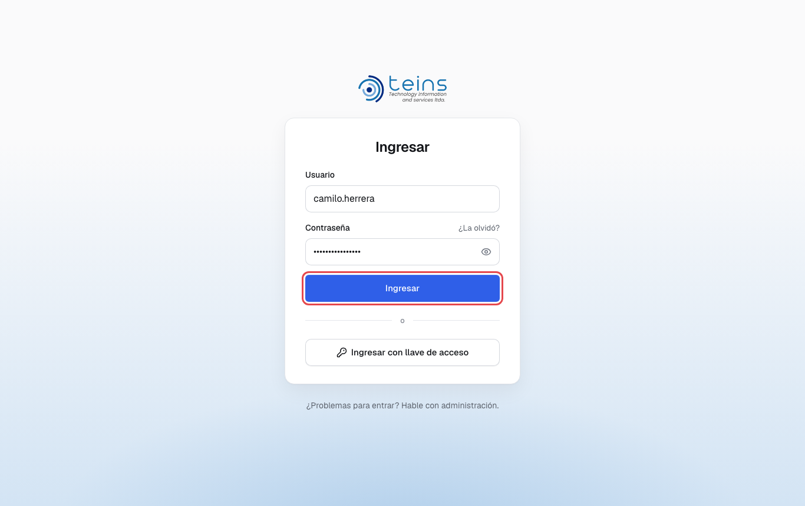

3. Aparece «Cree su contraseña»: escriba la contraseña nueva en «Contraseña nueva» y repítala en «Repita la contraseña nueva». Debajo se marcan los requisitos: «De 10 a 128 caracteres», «Distinta de la contraseña actual» y «Las dos coinciden».
4. Toque «Guardar y entrar». Aparece «Contraseña cambiada»: toque «Ir a Levantamientos». Las demás pantallas se abren después de cambiarla.

   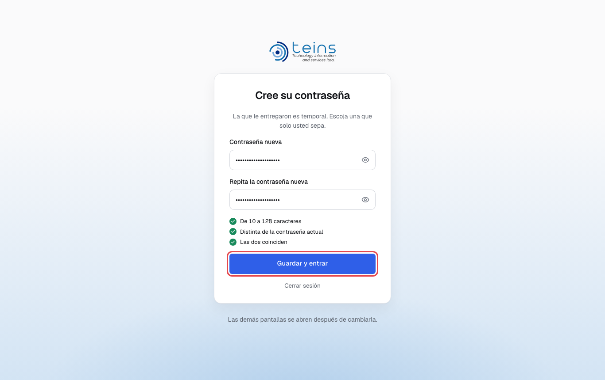

La próxima vez entre con su contraseña nueva. Si la olvida, toque «¿La olvidó?»: la respuesta es pedirle a administración que la restablezca (ver la sección 9).

### Segundo factor (para quien administra)

Las personas que administran deben activar un **segundo factor**: un código de 6 dígitos que da una app autenticadora en el celular (por ejemplo, Google Authenticator o Microsoft Authenticator).

1. Abra **Administración**. Si no lo ha activado, la pantalla dice «Active el segundo factor para administrar».
2. Escriba su contraseña en «Su contraseña» y toque «Continuar».
3. Escanee el código QR con la app autenticadora. Si no puede escanearlo, toque «¿No puede escanearlo?» y escriba la clave en la app, sin los espacios.
4. Escriba los 6 dígitos que muestra la app en «Código de 6 dígitos que muestra la app» y toque «Verificar y activar».

   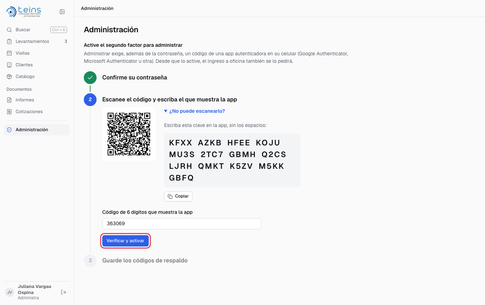

5. Aparece «Guarde los códigos de respaldo». Cada uno sirve una vez para entrar si pierde el celular, y **no se vuelven a mostrar**. Guárdelos con «Descargar» o «Copiar» en un lugar seguro y toque «Ya los guardé».

Desde ese momento, después de la contraseña, TEINS le pide el «Código de verificación». Escriba los 6 dígitos de la app y toque «Verificar». Si no tiene el celular, use uno de sus códigos de respaldo. «Volver a la contraseña» lo regresa a la pantalla anterior.

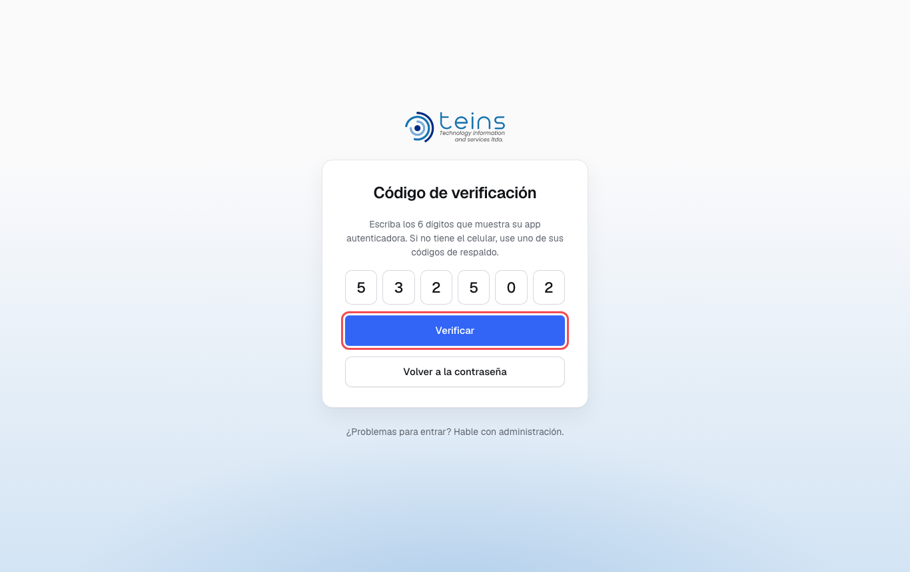

> Si el código no entra, revise que la hora del celular esté al día: la app autenticadora depende de ella.

### Mi cuenta

En **Mi cuenta** encuentra:

- **Acceso:** «Cambiar contraseña» (al cambiarla se cierran sus sesiones en los demás equipos), el estado del segundo factor y sus **llaves de acceso**. Una llave de acceso le permite entrar con la huella, el rostro o el PIN de ese equipo, con «Ingresar con llave de acceso». Para quien administra, el segundo factor dice «Obligatorio para administrar» y no se puede quitar.
- **Avisos de levantamientos enviados:** active «Activar avisos» para que el navegador le avise cuando llega un levantamiento, aunque la pestaña de TEINS esté cerrada.
- **Tema:** «Del sistema», «Claro» u «Oscuro». Se recuerda en ese equipo.
- **Cerrar sesión.**

### Si la sesión vence

Si deja TEINS abierto mucho tiempo o cierra la sesión en otra pestaña, aparece «Su sesión venció» encima de la pantalla, sin borrar lo que estaba haciendo. Ingrese de nuevo y verá «Sesión recuperada: lo que estaba haciendo sigue aquí».

---

## 3. Organizar el trabajo: clientes, sitios, contactos y visitas

### Clientes

La sección **Clientes** tiene dos pestañas: «Activos» y «Archivados». La columna «Reciben el informe» dice cuántos contactos reciben los documentos; si dice «Nadie», ese cliente no recibirá ningún correo.

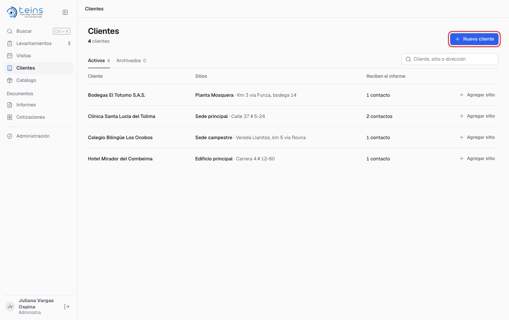

**Crear un cliente**

1. Toque «Nuevo cliente».
2. Llene **Cliente** (nombre y, si lo tiene, **NIT**), **Primer sitio** (nombre, dirección y ciudad) y **Contacto principal**, a quien le llegan los documentos.
3. Toque «Crear cliente».

El NIT y la ciudad son opcionales, pero salen en el encabezado del informe. Si faltan, el informe muestra el marcador `[NIT]` o `[Ciudad]` en su lugar.

**Dentro de un cliente**

Arriba ve el nombre, el NIT, cuántos sitios y contactos tiene, y los botones «Editar» y «Nuevo contacto». Debajo están los contactos, con lo que recibe cada uno y su acceso al portal, y los sitios.

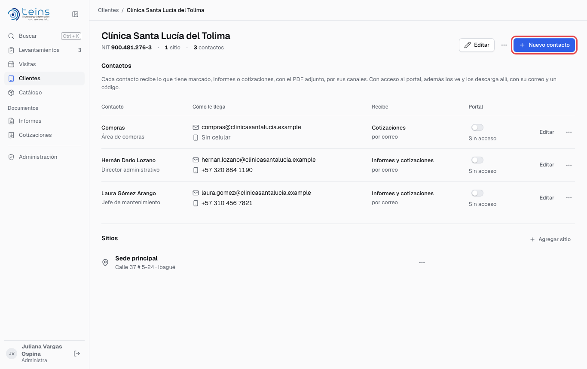

- «Editar»: cambia el nombre o el NIT. Lo ya publicado conserva el nombre con que salió.
- **Sitios:** «Agregar sitio»; en el menú de cada sitio, «Editar sitio» y «Archivar sitio». Si corrige la dirección de un sitio con una visita pendiente, el técnico ve la dirección nueva en su teléfono.
- Debajo del nombre aparece «Cambiado por [Nombre] · [fecha]» con el último cambio.

**Archivar un cliente**

1. En el menú del cliente («Más acciones»), elija «Archivar cliente».
2. Si tiene visitas por hacer, TEINS no lo deja archivar y le dice cuáles son. Cancélelas o espere a que se atiendan.
3. Al archivarlo, sale de las listas y de «Programar visita», y sus contactos dejan de recibir envíos. Sus informes, visitas y cotizaciones se conservan.

Para devolverlo, búsquelo en la pestaña «Archivados» y toque «Recuperar cliente».

### Contactos

Cada contacto recibe lo que tiene marcado, informes o cotizaciones, con el PDF adjunto.

1. En el cliente, toque «Nuevo contacto».
2. Escriba **Nombre**, **Cargo (opcional)**, **Correo** y **Celular**.
3. En «Recibe», marque «Los informes», «Las cotizaciones» o los dos.
4. En «Por», marque **Correo**.
5. Toque «Crear contacto».

Para cambiar un contacto, toque «Editar» en su fila y después «Guardar contacto». Para quitarlo, use su menú y «Quitar contacto»: deja de recibir los informes y se borran su correo y su celular; lo que ya recibió sigue en el historial de cada informe.

Si un correo rebota, el contacto muestra «El correo rebotó el [fecha]: revíselo».

> **WhatsApp todavía no está disponible.** La opción aparece en el formulario y pide marcar «[Nombre] autorizó recibir el informe por WhatsApp» (queda registrado quién lo confirmó y cuándo), pero por ahora los documentos solo llegan de verdad por correo. Marque siempre **Correo**.

### Visitas

La sección **Visitas** tiene tres pestañas: «Próximas», «Anteriores» y «Canceladas». Cada fila muestra la hora, el número de orden («Orden 0001»), el cliente y el sitio, los técnicos y el avance de sus levantamientos.

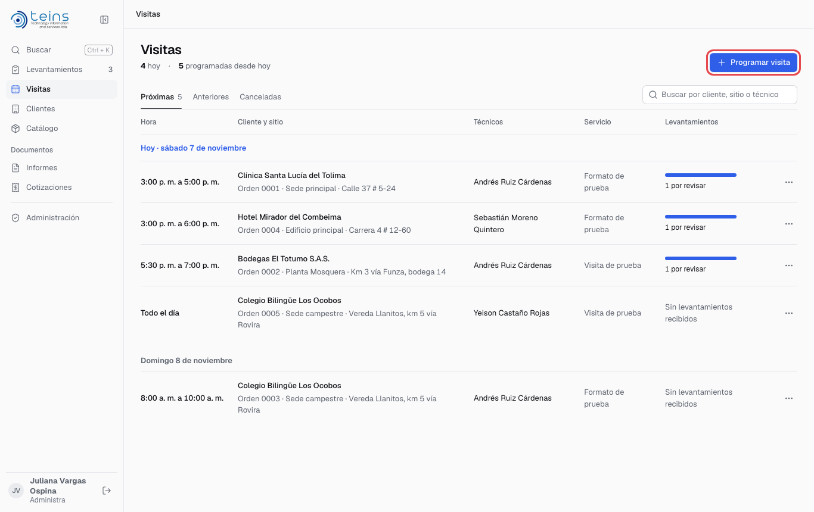

**Programar una visita**

1. Toque «Programar visita».
2. Elija el **Cliente** y el **Sitio**.
3. En «Cuándo», elija la **Fecha** y la **Hora**:
   - «Todo el día»: ocupa al técnico ese día entero.
   - Una hora de inicio con su **Duración** (de 30 minutos a 8 horas).
   - Una hora de inicio con «No sé cuánto dura»: el técnico queda ocupado hasta que la termine desde su teléfono.
4. Elija el **Motivo**: «Mantenimiento», «Cotización» o «Modificación».
5. En **Técnicos**, marque uno o varios. TEINS separa «Libres a esa hora» de «Ocupados», con el motivo de cada ocupado. Con «Buscar técnico» encuentra a alguien por su nombre.
6. Si aplica, elija el **Solicitante** (el contacto del cliente que pidió la visita) y escriba la **Referencia del cliente** (por ejemplo, el número de su ticket).
7. Toque el botón de abajo: con un técnico dice «Programar con [Nombre]»; con varios, «Programar la visita».

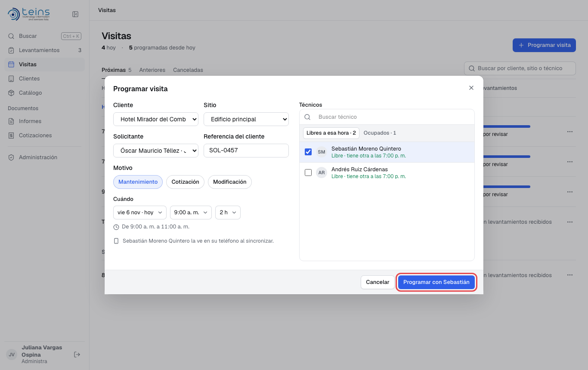

El **número de orden** lo asigna TEINS solo, en orden. Sale en la fila de la visita, en el informe y se puede buscar. El técnico ve la visita en su teléfono la próxima vez que abra la app con señal, y la tarjeta le dice a quién preguntar en el sitio.

**Cambiar una visita**

En la fila de la visita, abra «Más acciones»:

- «Reprogramar»: cambia fecha, hora, motivo, solicitante o referencia. Toque «Reprogramar la visita». Si el técnico ya empezó el levantamiento, lo puede seguir.
- «Reasignar técnicos»: agrega o quita técnicos. Si un técnico fue desactivado, la fila dice «Sin técnico» o «Se desactivó a [Nombre]», y aquí se elige otro.
- «Exportar cantidades»: descarga los materiales de la visita para Excel, con «Descargar el detalle (CSV)» y «Descargar el resumen (CSV)». Si hay levantamientos sin revisar, TEINS avisa que sus cantidades todavía pueden cambiar.
- «Cancelar visita»: escriba el motivo y confirme con «Cancelar visita». **No se puede deshacer**; si hace falta, programe otra. La visita pasa a «Canceladas» con quién la canceló, cuándo y por qué. Lo que el técnico ya empezó se conserva y lo puede enviar.

Cuando la visita tiene levantamientos revisados, la fila ofrece «Abrir el informe».

---

## 4. La bandeja y la revisión

### La bandeja

La sección **Levantamientos** es la bandeja. Tiene tres pestañas:

- «Esperando revisión»: llegaron y nadie los ha tomado. Se ordenan del que más lleva esperando al más reciente. La columna «Lleva esperando» dice «Hoy», «Desde ayer» o el número de días, y se pone en ámbar desde dos días.
- «En revisión»: alguien los tiene, y la columna «Revisión» dice quién.
- «Revisados»: listos para el informe.

Arriba puede buscar por cliente, sitio, técnico o formato. «Tomar el más antiguo» abre y toma el que más lleva esperando.

Un punto azul con «[Técnico] respondió · [hora]» indica que el técnico contestó una pregunta y usted no lo ha leído.

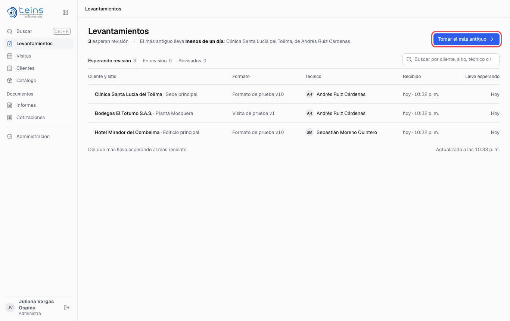

### Un solo editor a la vez

Un levantamiento solo lo corrige **la persona que lo tomó**. Así nadie pisa el trabajo de otro.

1. Abra el levantamiento. Arriba dice «Esperando revisión · nadie la ha tomado».
2. Toque «Tomar para revisar». Ahora dice «En revisión · la tomó usted» y aparece «Marcar revisado».

Si lo tiene otra persona, el botón dice «Tomar la revisión de [Nombre]». Al confirmar, esa persona pierde los cambios que no haya guardado, y el cambio de responsable queda registrado. Hágalo solo si lo acordaron.

### Cómo se ve la revisión

- A la izquierda, los datos del levantamiento por secciones: textos, medidas, selecciones, fotos, croquis, materiales y la firma del cliente.
- A la derecha, un panel con tres pestañas:
  - «En el informe»: el capítulo tal como saldrá en el informe. Lo corregido se ve resaltado (ese resaltado no sale en el PDF).
  - «Comentarios»: las conversaciones con el técnico.
  - «Historial»: todo lo que pasó con el levantamiento.

Puede cambiar el ancho del panel arrastrando el divisor, ampliarlo con «Ampliar», u ocultarlo y volver a abrirlo con «Mostrar el panel». En pantallas pequeñas, «Mostrar el panel» lo abre como hoja lateral.

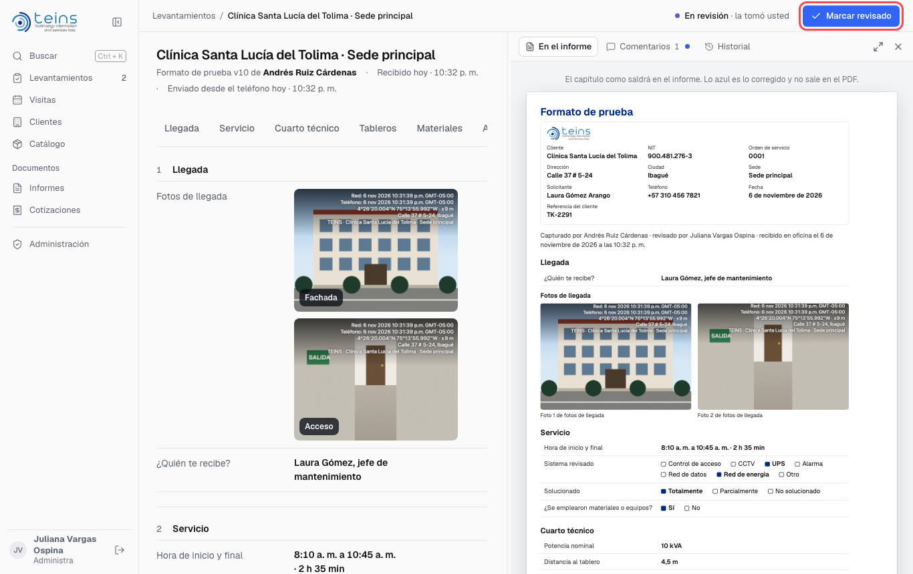

### Corregir un dato

Cada corrección queda registrada con su autor, el dato, el valor anterior, el valor nuevo y el motivo.

1. En la fila del dato, toque «Corregir».
2. Escriba el valor nuevo. Mientras escribe, «En el informe» muestra el valor nuevo enmarcado con «sin guardar».
3. Escriba el **Motivo de la corrección** (obligatorio, queda en el historial). Por ejemplo: «la placa dice 25 kVA».
4. Toque «Guardar corrección». En «En el informe» aparece el valor nuevo con «Antes: [valor anterior]».

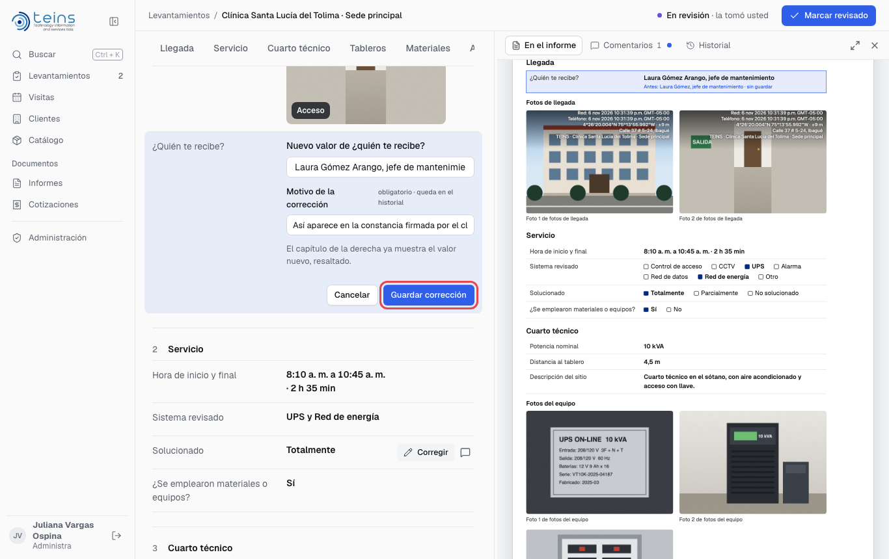

Si otra persona guardó el mismo dato antes que usted, TEINS le avisa y no pisa nada: revise el valor y vuelva a corregir si hace falta.

Las fotos, el croquis y la firma del cliente no se corrigen: se comentan.

**Materiales:** la tabla tiene la columna «Catálogo». En cada línea puede elegir el ítem del catálogo que corresponde; «Elegido en campo» indica que lo eligió el técnico. Para cambiar cantidades o líneas, use «Corregir» sobre la tabla.

### Comentar al técnico

Cuando algo no está claro, pregúntele al técnico sin llamarlo:

1. En la fila del dato, toque el icono de comentar (el globo).
2. Escriba la pregunta y toque «Enviar comentario». Lo que escriba le llega al técnico en su teléfono.
3. Cuando el técnico responde, aparece «Nuevo» en la conversación y el punto azul en la bandeja.
4. Para seguir la conversación, escriba en «Responder…» y presione Enter (Mayúsculas + Enter para otra línea).

En la pestaña «Comentarios» también puede escribir un comentario general, que no es sobre un dato. Bajo cada dato comentado aparece el resumen con «Ver la conversación».

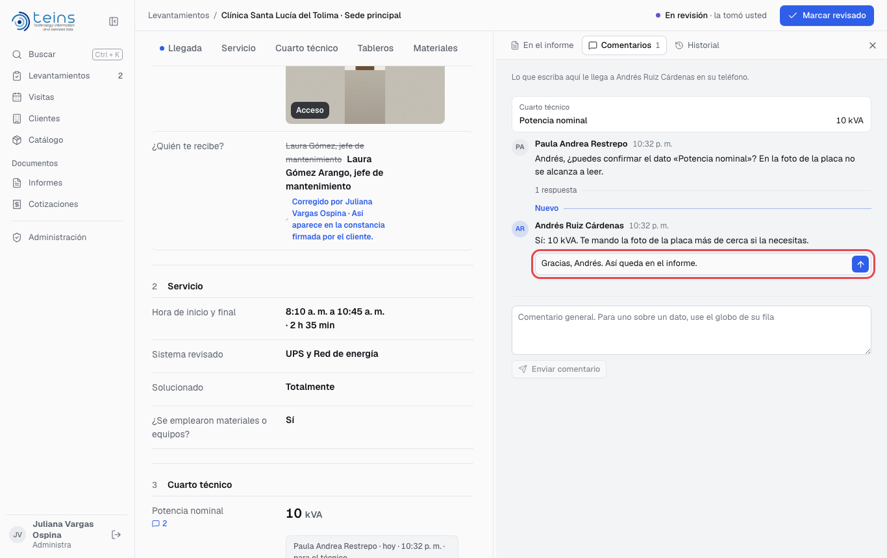

Para cambiar o retirar un comentario suyo, use su menú («Más acciones para el comentario»): «Editar» o «Borrar». Al borrar, la notificación ofrece «Deshacer».

### Marcar revisado

1. Cuando todo esté bien, toque «Marcar revisado».
2. La confirmación «¿Marcar revisado el levantamiento de [Técnico]?» dice que queda listo para el informe, que el técnico lo ve como revisado y que **las conversaciones se cierran**: el técnico las sigue viendo, pero ya no puede responder. Si dejó un comentario escrito sin enviar, también le avisa que se pierde. Confirme con «Marcar revisado».
3. Arriba queda «Revisado · por usted, [hora]», con «Abrir el informe», y «Siguiente: …» le ofrece el próximo levantamiento que espera revisión.

Después de marcarlo revisado, el levantamiento ya no se corrige desde la revisión.

### El historial

La pestaña «Historial» muestra, con autor y fecha: «Envió el levantamiento», «Tomó la revisión», «Corrigió» (con el valor anterior y el nuevo), «Comentó», «Respondió», «Vinculó al catálogo», «Marcó el levantamiento revisado» y más.

Arriba aparece el sello «Historial íntegro», que confirma que nadie alteró el historial por fuera de TEINS. Si alguna vez dice «El historial fue alterado fuera del sistema», avísele de inmediato a soporte.

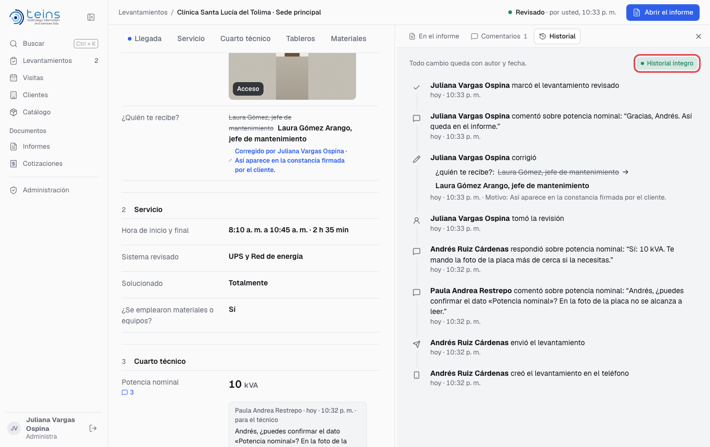

---

## 5. El informe

Hay un informe por visita. Se abre con «Abrir el informe» desde el levantamiento revisado o desde la fila de la visita. La sección **Informes** los lista todos con su estado: «Borrador», «Versión [N]», «Retirado del portal» o «Envío sin entregar».

### Armar el informe

A la izquierda está el editor; a la derecha, la **vista en vivo**: la hoja tal como la recibirá el cliente, que cambia mientras usted escribe.

El editor tiene cuatro partes:

1. **Introducción:** qué se visitó y para qué.
2. **Levantamientos:** cada uno es un capítulo del PDF. Marque la casilla de los que entran; solo entran los revisados. Ordénelos con el asa (o con el teclado: Espacio lo toma, las flechas lo mueven, Espacio lo suelta).
3. **Conclusiones:** qué se recomienda.
4. **Planos anexos:** con «Agregar planos en PDF» suba los planos que elabora oficina. Van al final del informe, en el orden que usted les dé. Si un plano dice que no se puede anexar, vuelva a exportarlo como PDF y súbalo de nuevo.

**Se guarda solo.** Junto a «Publicar» verá «Guardando» y luego «Guardado». No hay botón de guardar borrador. Si se va la conexión, dice «Sin conexión · se guarda al volver».

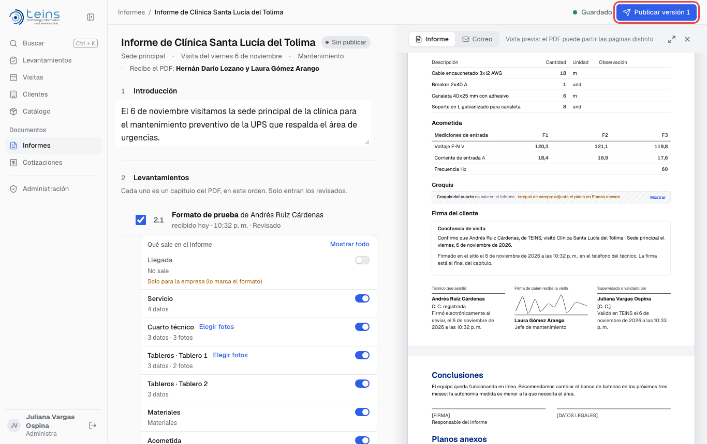

Si otra persona guarda el mismo informe mientras usted escribe, TEINS le pide elegir: «Guardar la mía encima» o «Cargar la guardada».

### Qué sale en el informe

Bajo cada levantamiento incluido está «Qué sale en el informe»:

- Un interruptor por cada bloque para dejarlo fuera.
- «Elegir fotos» para quitar fotos una por una.
- «Mostrar todo» para volver a incluir todo.
- En la vista en vivo, al pasar el puntero sobre una foto, «Ocultar». Lo oculto se ve rayado con «Mostrar».

Algunas partes nunca salen, porque así lo define el formato: por ejemplo, la llegada dice «Solo para la empresa (lo marca el formato)». El croquis del técnico tampoco sale: el plano formal se adjunta en Planos anexos.

Lo que no sale sigue en el levantamiento para oficina.

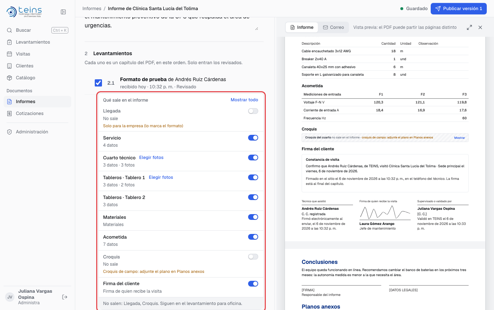

### La vista previa

- Arrastre el divisor para cambiar el ancho; doble clic lo devuelve al de siempre.
- «Ampliar la vista previa» y «Volver al editor».
- «Ocultar la vista previa» y, para traerla, «Mostrar la vista previa».
- La pestaña «Correo» muestra el correo que recibirá el contacto. Puede escribir sobre el asunto y el texto punteado; aparece «Volver al texto de TEINS» para deshacer su versión.

La vista previa y el PDF pueden partir las páginas distinto.

### Publicar

Una versión publicada **queda congelada: no se puede modificar**. Para corregir algo se publica una versión nueva, y la anterior se conserva.

1. Toque «Publicar versión [N]».
2. La confirmación «¿Publicar la versión [N]?» dice que el cliente la verá en el portal y, en «Enviar el PDF cuando esté listo», muestra los contactos que reciben informes. Marque o desmarque a quién enviarlo.
3. Confirme con «Publicar y enviar a [N]» o, si no marcó a nadie, con «Publicar versión [N]».

   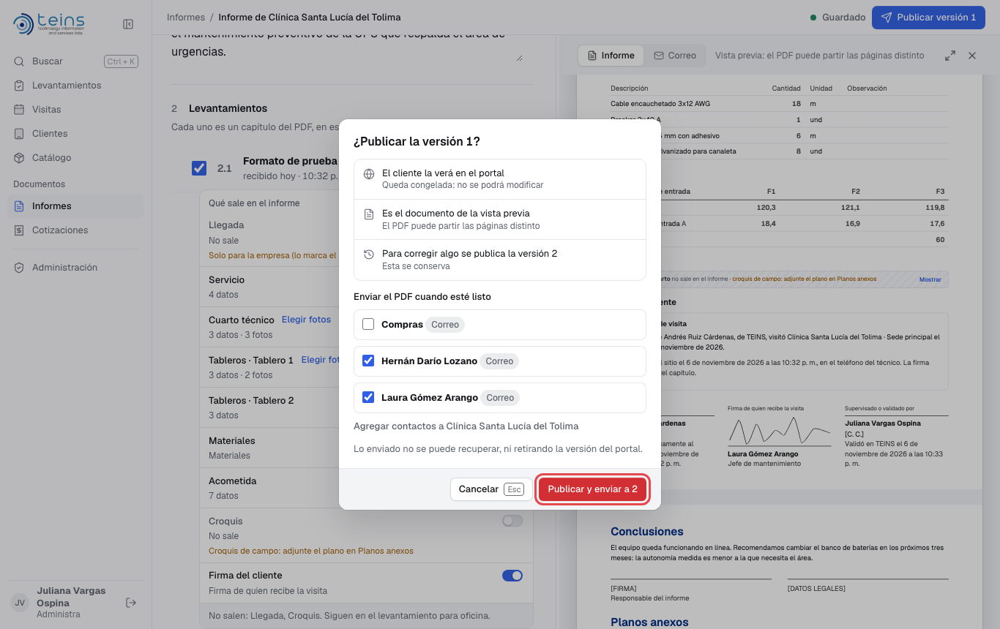
4. Arriba del editor ve el avance: publicada, el PDF (tarda unos segundos), el portal y cada envío. Si ya había una versión vigente, dice «Mientras, el cliente ve la versión [N]».
5. Cuando el PDF está listo, aparece «Descargar PDF de la versión [N]».

En «Versiones publicadas» quedan todas, con quién y cuándo las publicó, y la que dice «Vigente» es la que ve el cliente.

Publicar necesita conexión.

### Envíos y su estado

En «Envíos de la versión [N]» cada envío dice su estado:

| Estado | Qué significa |
|---|---|
| «En cola» | Espera a que el PDF esté listo. |
| «Enviado» | Salió hacia el contacto. Mientras el servidor del contacto no confirme, dice «El servidor del cliente no ha confirmado la entrega». |
| «Entregado» | Llegó al buzón del contacto. «· con su texto» indica que llevaba el texto que usted escribió. |
| «No llegó» | No se pudo entregar; dice el motivo. |
| «Cancelado» | No sale. |

- **Cancelar mientras está en cola:** toque «Cancelar» en la fila del envío. No pide confirmación, y la notificación ofrece «Deshacer». Una vez que salió, **lo enviado no se puede recuperar**.
- **Volver a enviar:** si dice «No llegó», corrija el correo del contacto en Clientes y toque «Volver a enviar» en su fila.
- **Enviar a otro contacto:** solo ofrece a quienes todavía no la recibieron. «Ver cómo llega» muestra al lado lo que recibirá.

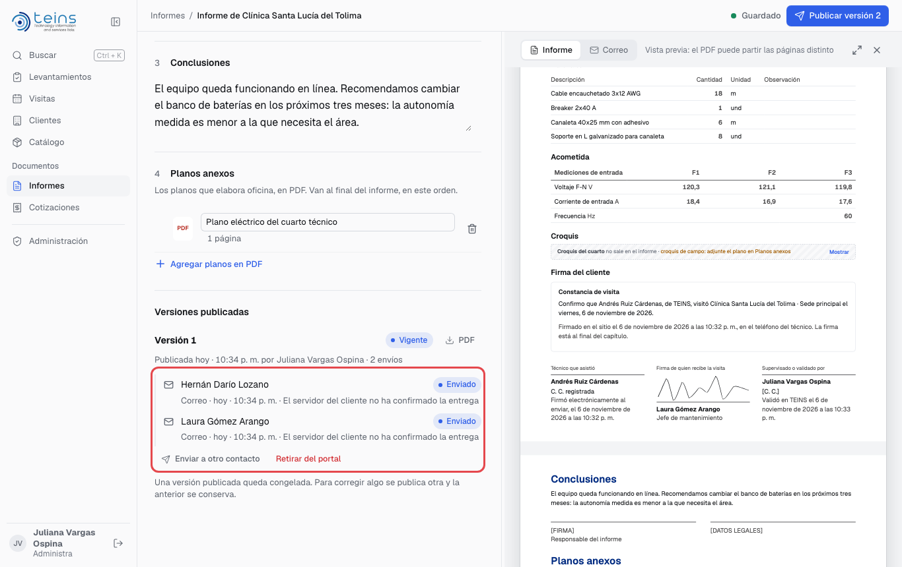

Si un envío no llegó, la lista de **Informes** marca ese informe con «Envío sin entregar».

### Retirar una versión del portal

Solo quien administra puede retirar una versión.

1. En «Versiones publicadas», toque «Retirar del portal» en la versión.
2. Escriba el motivo (queda en el registro) y confirme con «Retirar la versión [N]».
3. El cliente deja de verla: si hay una versión anterior sin retirar, verá esa. Si se retiran todas, el informe dice «Retirado del portal».

Retirar **no se puede deshacer**. Para volver a entregar, publique una versión nueva. Los envíos que estaban en cola se cancelan; si la versión ya le llegó a alguien, TEINS le dice a quién, porque esas copias no se pueden recuperar: avíseles que esa versión ya no vale.

---

## 6. Cotizaciones

Las cotizaciones salen de las **cantidades revisadas** de una visita, sumadas por ítem del catálogo.

### Crear una cotización

1. En **Cotizaciones**, toque «Nueva cotización».
2. Elija la visita. Solo aparecen visitas con levantamientos revisados: un levantamiento que falta revisar no entra, porque sus cantidades todavía pueden cambiar.
3. Toque «Crear cotización». TEINS le asigna un número `COT-[año]-[N]`.

### Ajustar las líneas

- Cada línea trae su **Cantidad** y su **Precio unitario** desde la **lista de precios** del catálogo. Si un ítem no tiene precio en la lista, la línea dice «Sin precio» y en la hoja aparece `[Precio]`. Por eso, **los precios dependen de la lista de precios que esté cargada**.
- Puede cambiar el precio solo para esta cotización; la línea muestra al lado el precio del catálogo («Catálogo: $[valor]»). Cambiar la lista de precios después no afecta la cotización publicada.
- «Agregar línea» para mano de obra u otros cobros («Agregada en oficina»).
- «Quitar» una línea; la notificación ofrece «Deshacer» y la devuelve a su lugar.
- **Totales:** elija «IVA 19 %» o «AIU» (administración, imprevistos y utilidad, con «IVA 19 % sobre la utilidad»). Los totales van en pesos, sin decimales.
- **Condiciones:** validez (de 1 a 365 días), forma de pago y notas para el cliente.

La hoja de la derecha cambia mientras escribe, y la pestaña «Correo» muestra lo que recibe el contacto. Se guarda solo, como el informe.

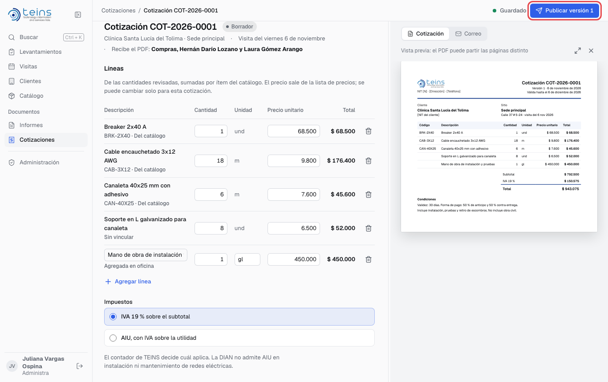

### Publicar y enviar

1. Toque «Publicar versión [N]». La cotización queda congelada con sus precios e impuestos.
2. En la confirmación, solo están marcados los contactos que reciben cotizaciones. Confirme con «Publicar y enviar a [N]».
3. Descargue el PDF con «Descargar PDF de la versión [N]».

Los envíos funcionan igual que en el informe (sección 5). Para corregir una cotización publicada, publique una versión nueva.

**Retirar versión** (solo quien administra, solo en la vigente): escriba el motivo y confirme. La cotización queda «Sin versión vigente» (o vuelve a la anterior, si la hay); el PDF se sigue descargando, pero ya no se puede volver a enviar.

---

## 7. Catálogo y lista de precios

El **Catálogo** tiene los ítems con los que oficina vincula los materiales que anota el técnico y con los que se arman las cotizaciones. Cada ítem tiene **Código**, **Descripción**, **Unidad** y **Precio sin IVA** (con la fecha desde la que rige).

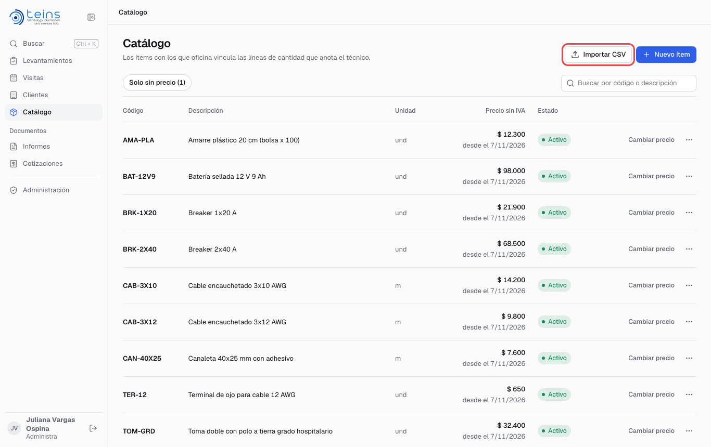

### Importar desde Excel

1. En Excel, prepare una hoja con las columnas **Código**, **Descripción** y **Unidad** (y **Precio**, si va a cargar la lista de precios).
2. Guárdela como **CSV (delimitado por comas)**.
3. En **Catálogo**, toque «Importar CSV» y después «Elegir archivo CSV».
4. TEINS dice cuántos ítems están listos y cuáles filas no se importan, con el motivo.
5. Toque «Importar [N] ítems». Al terminar dice «Importado: [N] ítems nuevos y [N] actualizados».

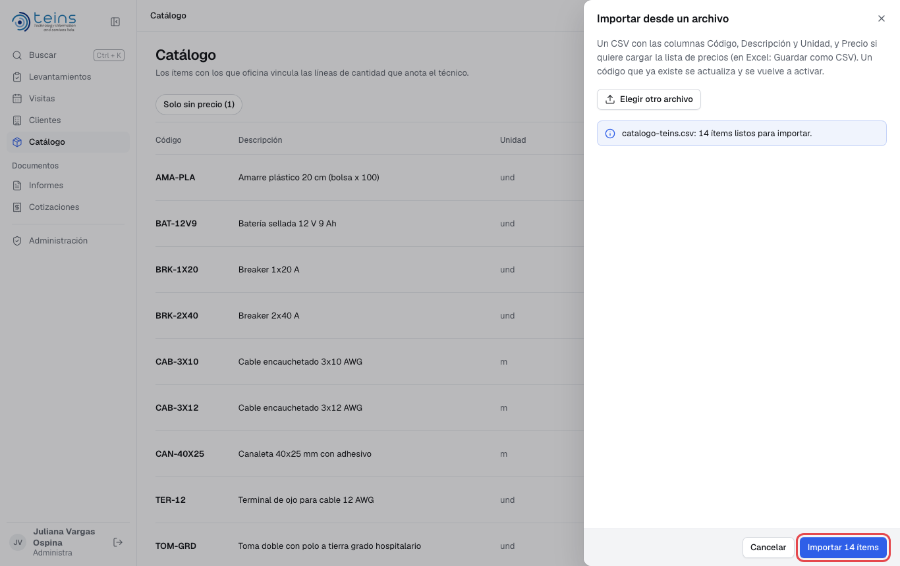

Los precios van en pesos enteros, como 4.800. Si usted no administra y el archivo trae precios, se importan los ítems sin ellos: los precios los carga administración.

### Un ítem a la vez

- «Nuevo ítem» crea uno a mano.
- En el menú de cada ítem: «Editar», «Desactivar» (con «Deshacer») y «Activar».
- **Cambiar precio** (solo quien administra): toque «Cambiar precio» en la fila. El diálogo muestra la historia de precios del ítem.
- «Solo sin precio ([N])» muestra los ítems activos que todavía no tienen precio. Conviene revisarlos antes de cotizar.

---

## 8. Portal del cliente

En el portal, cada contacto con acceso entra con su correo y un código que le llega cada vez, y ve y descarga lo que recibe: los informes y cotizaciones vigentes de su cliente. Nunca ve lo de otro cliente. No hay claves que entregarle a mano.

### Dar acceso a un contacto

1. En **Clientes**, abra el cliente.
2. En la lista de contactos, columna «Portal», toque el interruptor del contacto. Un contacto sin correo dice «Agregue un correo para darle acceso» y su interruptor no se puede tocar.
3. Revise la confirmación «¿Dar acceso al portal a [Nombre]?»: dice a qué correo le llega la invitación y qué verá.
4. Toque «Dar acceso». El contacto queda en «Aún no entra» y recibe el correo de invitación con «Entrar al portal».

![Confirmación «¿Dar acceso al portal a [Nombre]?»](capturas/oficina-21-dar-acceso-portal.png)

Cuando entra por primera vez, la columna muestra «Último ingreso: [fecha]».

El contacto ve lo mismo que recibe: si deja de recibir informes o cotizaciones, deja de verlos en el portal.

### Cómo entra el cliente

1. Abre el portal (desde «Entrar al portal» en la invitación o «Ver en el portal de TEINS» en el correo de un documento, que lo lleva directo a ese documento).
2. En «Sus informes y cotizaciones», escribe su correo y toca «Enviar código».

   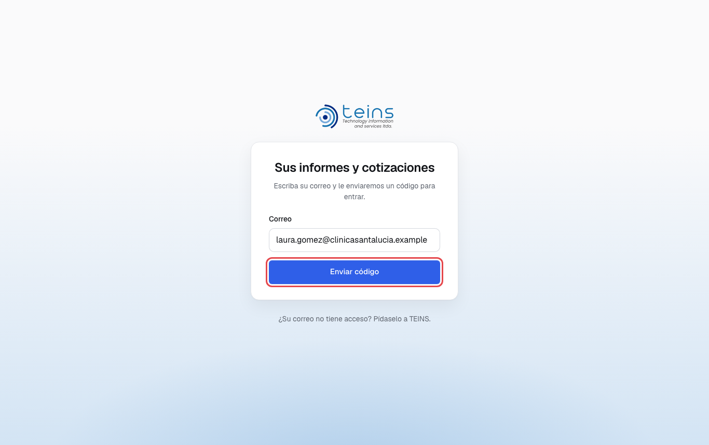

3. En «Revise su correo», escribe el código de 6 dígitos que le llegó y toca «Entrar». Si no le llega, puede tocar «Reenviar código» cuando termine la cuenta regresiva (un minuto) y revisar el correo no deseado. «Usar otro correo» vuelve al paso anterior.
4. Ve el nombre del cliente, las pestañas «Informes» y «Cotizaciones», y en cada documento «Descargar».

   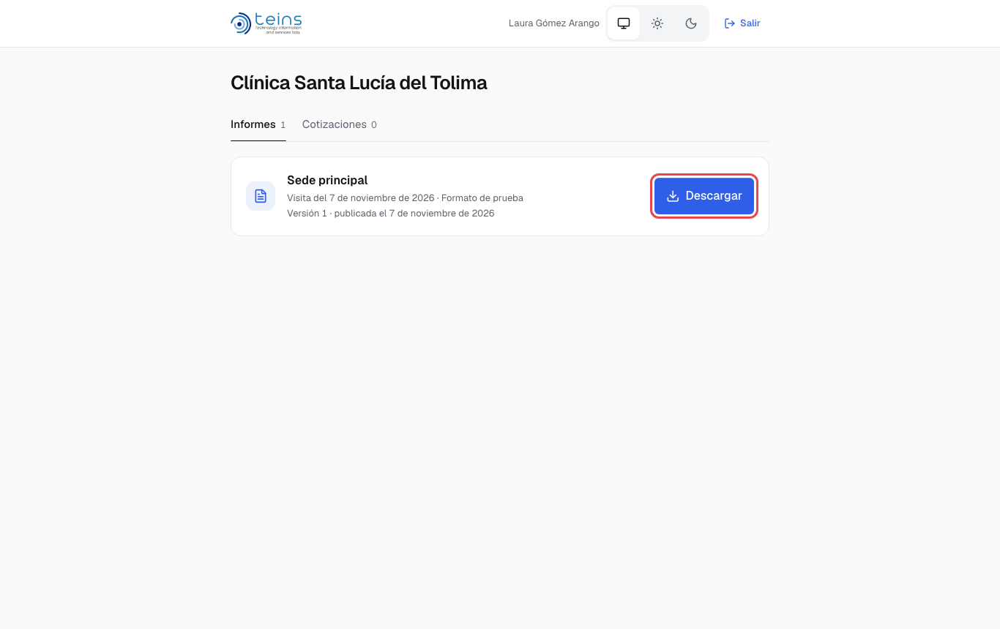

La sesión del portal se cierra sola después de 30 minutos sin uso. Para entrar de nuevo, el cliente pide otro código.

### Quitar o devolver el acceso

- **Quitar:** apague el interruptor del contacto. Se quita al instante, con la notificación «Acceso al portal quitado: [Nombre]» y «Deshacer». La próxima vez que el contacto recargue, el portal le pide el correo y ya no le llega el código.
- **Devolver:** toque «Deshacer» enseguida (sin otra invitación) o vuelva a encender el interruptor (con invitación nueva).

### Accesos sin uso por 12 meses

Por seguridad, TEINS **quita solo** el acceso de un contacto que lleva 12 meses sin entrar al portal (o que nunca entró en los 12 meses desde que se le dio). Queda registrado. En la pantalla del cliente, ese contacto aparece de nuevo con «Sin acceso».

Si un cliente llama porque no le llega el código, revise su contacto: si dice «Sin acceso», vuelva a darle acceso con el interruptor.

---

## 9. Administración

La sección **Administración** solo la ven quienes tienen la marca de administrador y el segundo factor activo (sección 2). Tiene dos pestañas: «Usuarios» y «Teléfonos de campo».

### Usuarios

**Crear un usuario**

1. Toque «Nuevo usuario».
2. Escriba **Nombre completo** y **Usuario para iniciar sesión** (de 3 a 30 letras minúsculas, números, punto o guion, sin espacios).
3. Elija el **Rol**: «Técnico (campo)» u «Oficina».
4. Si quiere, escriba la **Cédula**: sale en la firma de los informes que esta persona atiende o revisa. Solo la ve quien administra.
5. Toque «Crear usuario».
6. Aparece la **contraseña temporal una sola vez**. Cópiela con «Copiar» y entréguela en persona o por un medio distinto al del usuario. Toque «Ya la entregué».

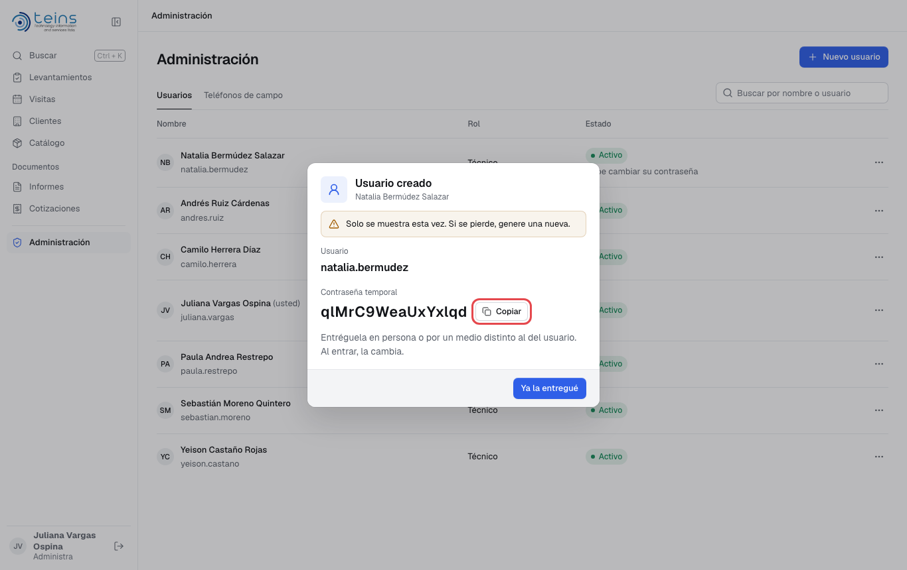

La persona la cambia al entrar. Mientras no lo haga, su fila dice «Debe cambiar su contraseña».

**Menú de cada usuario («Más acciones»)**

- «Poner cédula» o «Cambiar cédula». Queda registrado quién la cambió y cuándo, pero no su valor. Si un informe dice `[C. C.]`, a esa persona le falta la cédula.
- «Restablecer contraseña»: le entrega una contraseña temporal nueva, cierra sus sesiones en todos los equipos y le quita el segundo factor y las llaves de acceso. Úselo cuando alguien olvidó su contraseña. Su propia contraseña se cambia en **Mi cuenta**.
- «Dar administración» o «Quitar administración» (solo usuarios de oficina). Quien la recibe debe activar el segundo factor para usarla.
- «Desactivar usuario»: la persona no podrá entrar. Si es técnico, sus teléfonos borran sus datos al conectarse. Lo que ya envió y su autoría se conservan.

**Reactivar:** en la fila de un usuario desactivado, toque «Reactivar usuario». Le entrega una contraseña temporal (se muestra una sola vez) y no recupera sesiones, llaves ni segundo factor.

Si un usuario de oficina se desactiva mientras tenía un levantamiento en revisión, este queda sin responsable y cualquiera lo puede tomar con «Tomar para revisar».

### Teléfonos de campo

Esta pestaña muestra cada teléfono que se ha conectado, con su técnico, «Último contacto» y versión de la app, lo que tiene «Sin enviar», el almacenamiento y el «Estado».

- Si un técnico tiene algo sin enviar desde hace más de un día, aparece «El más antiguo espera desde [fecha]. Llame al técnico.»
- «No persistente: el sistema puede borrar los datos» indica que ese teléfono podría perder lo que no ha enviado. Pídale al técnico que envíe cuanto antes y que instale la app desde el ícono (manual para técnicos, sección 2).

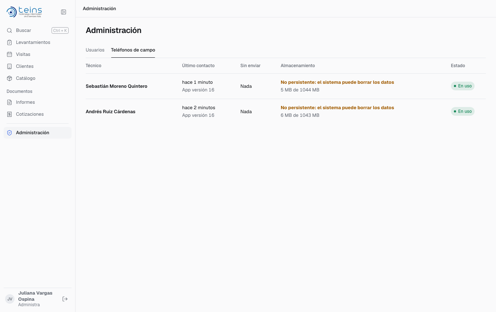

**Si un técnico pierde el teléfono o se lo roban:**

1. Desactive al técnico en «Usuarios» con «Desactivar usuario». El teléfono queda en «Borrado pendiente» («Se hará al conectarse») y, cuando vuelva a tener señal, borra los datos del técnico y pasa a «Datos borrados».
2. Cuando el técnico tenga un teléfono nuevo, toque «Reactivar usuario» y entréguele la contraseña temporal.

Ojo: lo que el técnico no alcanzó a enviar desde el teléfono perdido no se puede recuperar.

### Retirar versiones

Retirar una versión de un informe o de una cotización se hace desde el propio documento (secciones 5 y 6), y solo lo ve quien administra.

---

## 10. Búsqueda y atajos del teclado

### Buscar en todo

Presione ⌘K en Mac (Ctrl + K en Windows) o toque **Buscar** en el menú. Se abre «Buscar en oficina» con:

- **Recientes:** lo último que abrió.
- **Acciones:** «Programar visita», «Nuevo cliente», «Nueva cotización» y «Tomar el más antiguo».
- **Secciones** del menú.

Escriba parte de un nombre (sin importar tildes ni mayúsculas) y presione Enter. Los resultados salen agrupados: clientes, visitas, levantamientos, informes y cotizaciones. Con las flechas se mueve entre ellos, con Enter abre y con Esc cierra.

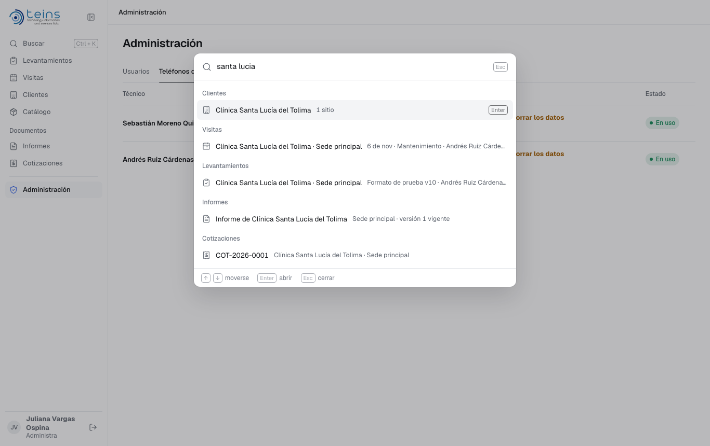

Cada lista también tiene su propio buscador, y TEINS recuerda la pestaña y la búsqueda de cada sección cuando usted vuelve.

### Atajos

Presione «?» para ver la lista «Atajos del teclado». Las letras solas no hacen nada mientras escribe en un campo.

| Dónde | Tecla | Qué hace |
|---|---|---|
| En toda oficina | ⌘K / Ctrl + K | Buscar e ir |
| En toda oficina | ⌘B / Ctrl + B | Plegar el menú |
| En toda oficina | ? | Ver los atajos |
| En toda oficina | Esc | Cerrar o volver |
| Bandeja | J y K (o ↓ y ↑) | Bajar y subir |
| Bandeja | Enter | Abrir |
| Bandeja | / | Buscar en la lista |
| Revisión | T | Tomar para revisar |
| Revisión | R | Marcar revisado (pide confirmar) |
| Revisión | S | Siguiente levantamiento |
| Revisión | Esc | Volver a la bandeja |

---

## 11. Problemas frecuentes y a quién pedir ayuda

Cada problema empieza por lo que usted ve en la pantalla y sigue con qué hacer.

**No puedo entrar: «Usuario o contraseña incorrectos».**
Revise mayúsculas y que el usuario esté bien escrito. Si olvidó la contraseña, pídale a quien administra que la restablezca. Si su cuenta fue desactivada, también verá este mensaje.

**El código del segundo factor no entra.**
Revise que la hora del celular esté al día. Si no tiene el celular, use un código de respaldo. Si los perdió, pídale a otra persona que administre que le restablezca la contraseña: tendrá que activar el segundo factor de nuevo.

**No veo Administración.**
Esa sección es para quienes administran. Si la necesita, pídasela a quien administra en TEINS.

**Abro Administración y dice «Active el segundo factor para administrar».**
Es la primera vez que administra: siga los pasos de la sección 2 («Segundo factor»). Sin él no se abren usuarios, teléfonos ni precios.

**El técnico dice que envió, pero no está en la bandeja.**
Si en su teléfono dice «Esperando señal» o «Sin señal», todavía no llega: debe abrir la app con señal. Si en Administración › «Teléfonos de campo» su fila dice «Sin enviar», llámelo. Revise también las pestañas «En revisión» y «Revisados»: alguien pudo tomarlo ya.

**No puedo corregir un dato.**
Primero tome el levantamiento con «Tomar para revisar». Si ya está revisado, ya no se corrige desde la revisión.

**El técnico dice que no ve mi comentario.**
Le llega cuando abre la app con señal. Si usted ya marcó el levantamiento revisado, la conversación quedó cerrada.

**El levantamiento no aparece en el informe.**
Solo entran los revisados. Márquelo revisado y vuelva al informe para marcar su casilla.

**Me equivoqué en un informe ya publicado.**
Corrija en el editor y publique la versión siguiente. La anterior se conserva. Si el error es grave, pídale a quien administra que retire la versión equivocada del portal y avísele al cliente.

**Publiqué y no aparece «Descargar PDF de la versión [N]».**
El PDF tarda unos segundos en generarse. Espere y no publique otra vez. Si pasan varios minutos, recargue la página.

**El PDF dice «No se generó. Avísele a soporte.»**
No reintente varias veces: avísele a soporte con el cliente y el número de versión.

**Un envío dice «No llegó».**
Revise el correo del contacto en Clientes (puede tener un error o haber rebotado), corríjalo y toque «Volver a enviar».

**La cotización dice «Falta el precio de [N] líneas».**
Escriba el precio en esas líneas, o pídale a quien administra que lo cargue en el catálogo para las próximas.

**El cliente dice que no le llega el código del portal.**
Pídale que revise el correo no deseado. En TEINS, revise que su contacto tenga el correo bien escrito y que la columna «Portal» no diga «Sin acceso» (el acceso se quita solo tras 12 meses sin uso). Si lo dice, vuelva a darle acceso.

**Aparece «Hay una versión nueva de TEINS: recargue la página e intente de nuevo».**
Recargue la página del navegador. Lo que ya estaba guardado no se pierde.

**Se fue internet mientras escribía el informe.**
Siga escribiendo: se guarda solo cuando vuelve la conexión. Publicar sí necesita conexión.

**Un técnico tiene algo «Sin enviar» desde hace días.**
Llámelo: debe abrir la app con señal para que se envíe. Nunca le pida que borre la app ni sus datos: lo que no ha enviado solo existe en su teléfono.

### A quién pedir ayuda

- **Usuarios, contraseñas, accesos y precios:** la persona que administra TEINS en su empresa.
- **Errores que no se resuelven recargando la página** (un PDF que no se genera, un historial que dice que fue alterado, una pantalla que no carga): soporte de TEINS, kevin.beltran@estudiantesunibague.edu.co. Diga qué estaba haciendo, el cliente, la visita y la hora aproximada. No envíe datos de clientes por canales no autorizados.

---

## 12. Glosario

| Palabra | Qué quiere decir |
|---|---|
| **Visita** | Lo que oficina programa: un cliente, un sitio, una fecha, un horario y uno o varios técnicos. Tiene un número de orden. |
| **Levantamiento** | Lo que un técnico captura en una visita: datos, fotos, croquis, materiales y la firma de quien lo recibe. |
| **Formato** | La lista de secciones y datos de un tipo de levantamiento (por ejemplo, servicio de UPS o visita técnica). |
| **Borrador** | Un levantamiento que el técnico empezó y no ha enviado: solo existe en su teléfono. También, un informe o una cotización sin publicar. |
| **Enviar** | Lo que hace el técnico para pasar su levantamiento a oficina. Después solo oficina lo corrige. |
| **Bandeja** | La sección **Levantamientos**: lo que llegó de campo, por estado. |
| **Revisar** | Tomar un levantamiento, corregir lo necesario (con motivo) y preguntarle al técnico. |
| **Revisado** | El levantamiento ya puede entrar al informe. Las conversaciones se cierran. |
| **Corrección** | Un cambio de oficina sobre un dato del técnico. Queda en el historial con autor, valor anterior, valor nuevo y motivo. |
| **Informe** | El documento PDF de una visita para el cliente, con los levantamientos revisados, la introducción, las conclusiones y los planos. |
| **Publicar** | Congelar una versión del informe o de la cotización, generar su PDF y enviarla a los contactos. |
| **Versión** | Cada publicación. No se modifica: para corregir se publica la siguiente y la anterior se conserva. La «Vigente» es la que ve el cliente. |
| **Retirar** | Quitar una versión del portal (solo quien administra). No se puede deshacer. |
| **Cotización** | El documento de precios que sale de las cantidades revisadas de una visita. |
| **Catálogo** | Los ítems (código, descripción, unidad y precio sin IVA) con los que se vinculan los materiales y se arman las cotizaciones. |
| **Contacto** | Una persona del cliente que recibe informes, cotizaciones o los dos. |
| **Portal** | La página donde un contacto con acceso entra con su correo y un código y descarga lo que recibe. |
| **Segundo factor** | El código de 6 dígitos de una app autenticadora, obligatorio para administrar. |
| **Contraseña temporal** | La que entrega quien administra al crear o restablecer un usuario. Se cambia al entrar. |

