# Manual para técnicos de campo

Versión del manual: 0.9.0 (piloto).

## Contenido

0. [Guía rápida](#guía-rápida)
1. [Qué es y para qué sirve](#1-qué-es-y-para-qué-sirve)
2. [Instalar la app y entrar por primera vez](#2-instalar-la-app-y-entrar-por-primera-vez)
3. [Tu día: la pantalla de inicio](#3-tu-día-la-pantalla-de-inicio)
4. [Hacer un levantamiento paso a paso](#4-hacer-un-levantamiento-paso-a-paso)
5. [Trabajar sin señal](#5-trabajar-sin-señal)
6. [Después de enviar](#6-después-de-enviar)
7. [Descartados: borrar y recuperar](#7-descartados-borrar-y-recuperar)
8. [Problemas frecuentes](#8-problemas-frecuentes)
9. [A quién pedir ayuda](#9-a-quién-pedir-ayuda)
10. [Glosario](#10-glosario)

En este manual, lo que va entre «comillas» es el texto exacto que ves en la pantalla. Las capturas son de un cliente y un formato de ejemplo: los nombres y los pasos de tu formato pueden ser otros.

---

## Guía rápida

Una visita normal, de principio a fin. Imprime esta página y llévala contigo.

1. **Antes de salir**, abre TEINS con señal. Revisa que la franja de arriba diga «todo subido» y que la visita del día esté en «Siguiente visita».
2. **Al llegar**, en la tarjeta de la visita toca el formato que vas a usar, debajo de «Iniciar levantamiento».
3. **Foto de llegada:** espera «Ubicación lista» y toma la foto de la fachada y la del acceso.
4. **Llena cada paso.** Todo se guarda solo en el teléfono, con o sin señal. Usa «Siguiente» para avanzar.
5. **Fotos:** toca cada recuadro (por ejemplo «Placa») y toma la foto.
6. **Un dato que no puedes obtener:** marca «No se pudo obtener» y escribe el motivo.
7. **Croquis y materiales:** dibuja el croquis y agrega los materiales con «Buscar en el catálogo».
8. **Firma:** toca «Entregar el teléfono» y que quien te recibió escriba su nombre y firme.
9. **Enviar:** «Revisar y enviar», luego «Enviar a oficina» y «Enviar levantamiento». Sin señal también se puede: sale solo cuando vuelva.
10. **Antes de irte**, mira que diga «Recibido en oficina». Si no hay señal, abre la app más tarde con señal. Nunca borres la app con algo sin enviar.

Si algo falla, anota el texto exacto de la pantalla y llama a oficina.

---

## 1. Qué es y para qué sirve

La app de TEINS es donde capturas el levantamiento de cada visita: datos, fotos, croquis, materiales y la firma de quien te recibe.
Funciona con o sin señal: todo queda guardado en tu teléfono y se envía solo a oficina cuando hay conexión.
Oficina revisa lo que enviaste, te pregunta por chat si algo no está claro y arma el informe para el cliente.

---

## 2. Instalar la app y entrar por primera vez

### Antes de empezar

- Pídele a oficina tu **usuario** y tu **contraseña temporal**. Sin eso no puedes entrar.
- Hazlo **con señal** (Wi-Fi o datos). La primera vez la app necesita conexión para descargar tus visitas y los formatos.
- Hazlo en el teléfono que vas a usar en campo.

### En iPhone (Safari)

Importante: instala la app **antes** de iniciar sesión. Lo que captures en Safari no pasa a la app instalada.

1. Abre en **Safari** la dirección que te dio oficina.
2. Verás «Instala la app». Sigue los pasos que aparecen:
   1. «Toca Compartir» (el cuadro con la flecha hacia arriba, en la barra de Safari, abajo). Si no lo ves, toca primero los tres puntos.
   2. Elige «Agregar a inicio». Si no aparece, baja en la lista.
   3. «Abre TEINS desde tu pantalla de inicio».
3. Cierra Safari y abre **TEINS desde el ícono** de tu pantalla de inicio. De ahí en adelante, entra siempre por el ícono, nunca por Safari.

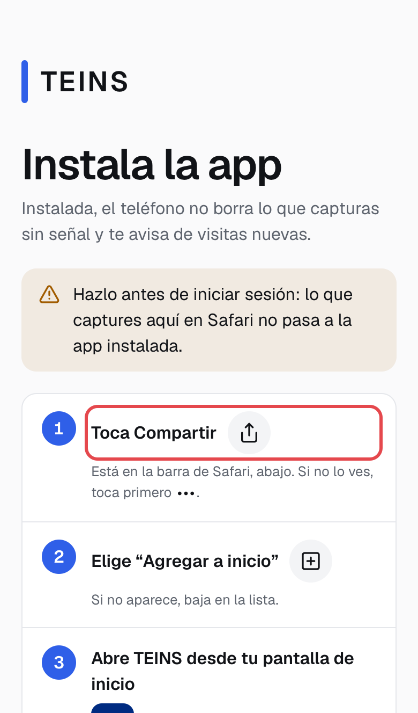

Si tocas «Seguir en Safari», la app funciona, pero el teléfono puede borrar lo que capturas sin señal. Úsalo solo si oficina te lo indica. Mientras no la instales, el inicio te lo recuerda con «Instala TEINS para no perder datos» y el enlace «Cómo instalarla».

### En Android (Chrome)

1. Abre en **Chrome** la dirección que te dio oficina.
2. Toca «Instalar la app» y confirma. Si no aparece el botón:
   1. «Abre el menú del navegador» (los tres puntos).
   2. Elige «Instalar app» o «Agregar a pantalla principal» (el nombre cambia según el navegador).
3. Abre TEINS desde su ícono.

### Entrar por primera vez

1. En «Ingresar», escribe tu «Usuario» y tu «Contraseña» (la temporal que te dio oficina) y toca «Ingresar».

   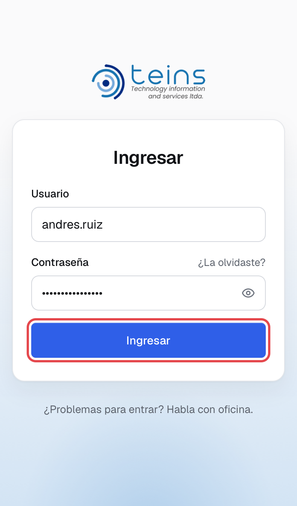

2. La app te muestra «Crea tu contraseña». La que te entregaron es temporal: escoge una que solo tú sepas.
   - Escríbela en «Contraseña nueva» y otra vez en «Repite la contraseña nueva».
   - Debajo se marcan los requisitos: «De 10 a 128 caracteres», «Distinta de la contraseña actual» y «Las dos coinciden».
3. Toca «Guardar y entrar». Verás «Listo». Toca «Ir a mis visitas».

   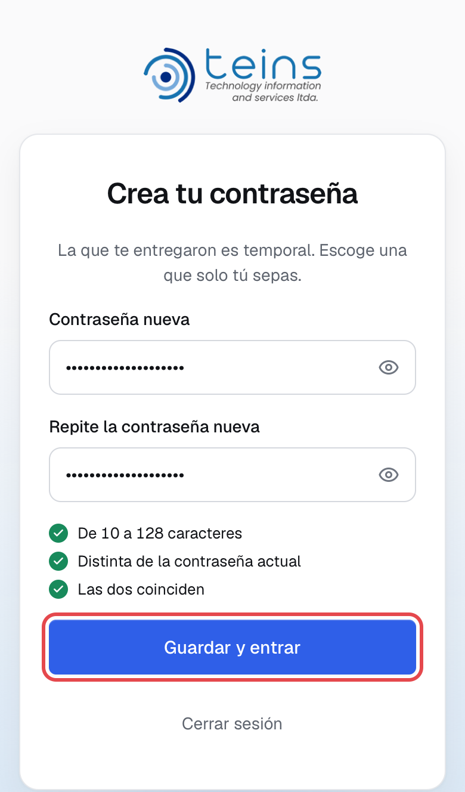

### Llave de acceso (entrar sin escribir la contraseña)

Después de entrar, en el inicio puede salir «Entra sin escribir la contraseña».

1. Toca «Crear llave de acceso».
2. Confirma con Face ID, huella o el PIN del teléfono.
3. La próxima vez, en la pantalla de ingreso toca «Ingresar con llave de acceso».

Si no la quieres, toca «Ahora no». Si oficina te restablece la contraseña, la llave deja de servir y debes entrar con usuario y contraseña.

### Activar los avisos

En el inicio aparece «Avisos en este teléfono». Te avisan cuando oficina te asigna, cambia o cancela una visita, y cuando comenta o revisa un levantamiento.

1. Toca «Activar avisos».
2. Cuando el teléfono pregunte, toca **Permitir**.
3. Verás «Avisos activados en este teléfono.»

En iPhone, los avisos solo funcionan con la app instalada (abierta desde el ícono).

---

## 3. Tu día: la pantalla de inicio

Arriba ves la fecha, «Hola, [tu nombre]» y un círculo con tus iniciales: ese es «Tu cuenta».

Debajo hay una franja que dice cómo va el envío, por ejemplo «Guardado en el teléfono · todo subido» o «Sin señal · 1 levantamiento espera para subir. Puedes seguir.».

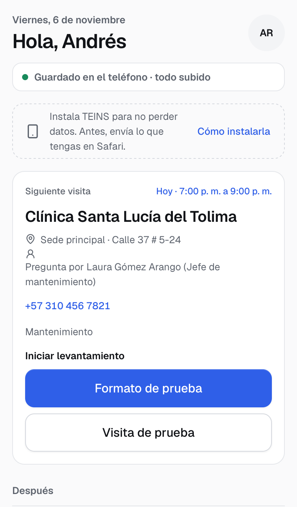

### Las partes del inicio

| Sección | Qué muestra |
|---|---|
| «Siguiente visita» | La visita que te toca ahora. Es la tarjeta grande de arriba. |
| «Necesita atención» | Lo que no pudo entrar a oficina y lo que oficina te escribió y no has leído («Oficina te escribió»). |
| «Después» | Tus otras visitas pendientes. Tócala para ver sus botones. |
| «Atendidas hoy» | Las visitas de hoy que ya enviaste o terminaste. |
| «Sin terminar» | Levantamientos empezados que ya no tienen visita. |
| «Enviados» | Lo que ya enviaste, con su estado. |

Si no tienes nada, verás «Sin visitas asignadas» o «No tienes visitas pendientes». Cuando oficina te asigne una visita, aparece aquí al tener señal.

### Qué dice la tarjeta de una visita

- **Cuándo:** por ejemplo «Hoy · 9:00 a. m. a 11:00 a. m.» o «Mañana · Desde 2:00 p. m.». Si ya empezó y no tiene hora de fin, dice «En curso · desde [hora]».
- **Cliente:** el nombre de [Cliente].
- **Sitio y dirección:** [Sitio] · [Dirección].
- **A quién buscar:** «Pregunta por [Nombre] ([Cargo])», con su celular. Toca el número para llamar.
- **Servicio** de la visita: el formato que vas a llenar.
- **Avance**, si ya empezaste: por ejemplo «3 de 6 pasos · sigue materiales».
- **Los botones:** «Iniciar levantamiento» empieza el formato del servicio de la visita. Si la visita se programó antes de elegir servicios, ves un botón por cada formato. Si ya empezaste, dice «Continuar levantamiento»; si ya enviaste, «Ver lo que enviaste».

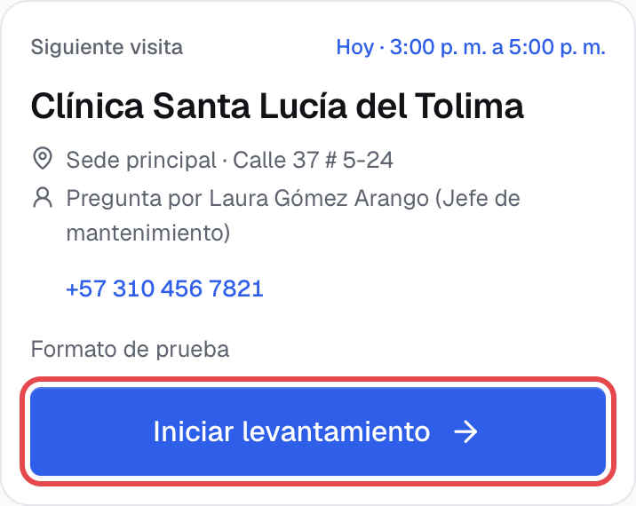

### Una visita de otro día no se puede iniciar

Si la visita es de mañana o de otro día, en lugar de los botones verás «Podrás iniciarla mañana» o «Podrás iniciarla el [día]». Los botones aparecen solo el día de la visita.

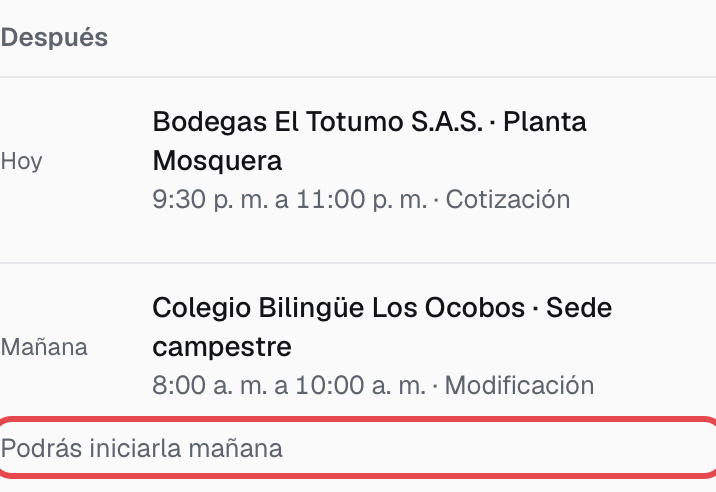

Si ya habías empezado un levantamiento y oficina movió la visita a otro día, puedes seguirlo con «Continuar levantamiento».

### Visitas canceladas o reasignadas

Si oficina cancela la visita o se la asigna a otra persona y tú ya habías empezado, verás «Oficina canceló esta visita.» o «Esta visita se asignó a otra persona.». Puedes terminar y enviar lo que ya empezaste, pero no iniciar uno nuevo.

---

## 4. Hacer un levantamiento paso a paso

**Regla:** cada visita lleva **un solo levantamiento**. Una vez enviado, la visita solo ofrece «Ver lo que enviaste».

### 4.1 Empezar

1. En la tarjeta de la visita, toca el formato que corresponde, debajo de «Iniciar levantamiento».
2. La app abre el primer paso. Cada sección del formato es un paso: arriba ves «Paso [N] de [Total] · [nombre del paso]» y, a la derecha, un contador de cuántos pasos llevas completos (por ejemplo «3/8»).
3. Cada dato se guarda en el teléfono apenas lo escribes. No hay botón de guardar.

Para moverte:

- «Siguiente: [paso]», abajo, te lleva al paso que sigue.
- El contador de arriba a la derecha (o la flecha de la izquierda) abre «El recorrido»: la lista de todos los pasos, cuáles están completos, cuáles faltan y dónde vas («Sigue aquí»). Toca cualquiera para ir a él.
- «Volver a mis visitas» te saca al inicio. Lo capturado queda guardado; luego entras con «Continuar levantamiento».

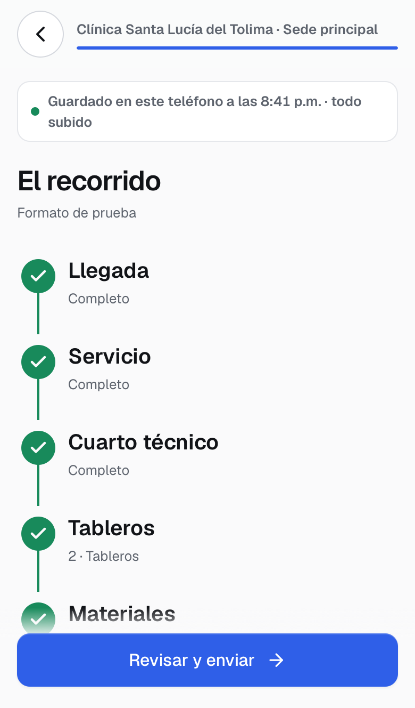

### 4.2 Foto de llegada

Si el formato lo pide, el primer paso es la **Llegada**, con fotos como la fachada y el acceso.

1. La primera vez, el teléfono te pide permiso para usar tu ubicación. Toca **Permitir al usar la app**.
2. Espera a que diga «Ubicación lista (±[N] m)». Mientras busca, dice «Buscando ubicación…».
3. Toca el recuadro de cada foto (por ejemplo «Fachada») y toma la foto.
4. La foto queda con una franja que dice:
   - «Red: [hora]» (la hora oficial) y «Teléfono: [hora]» (la hora de tu teléfono),
   - las coordenadas y su precisión,
   - la dirección del sitio, el cliente y el sitio,
   - y un mapa pequeño con un pin, si había señal.

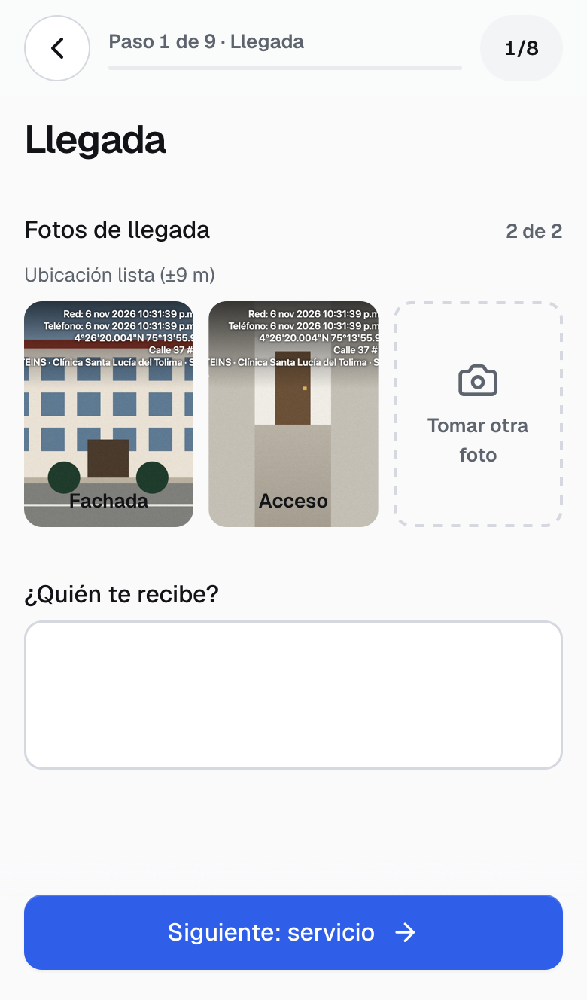

Sin señal la foto sale igual, con «Red: sin señal» y sin mapa. Si no diste permiso de ubicación, dice «Sin permiso de ubicación: la foto sale sin coordenadas».

Los formatos de TEINS (visita técnica y servicio de UPS) llevan la ubicación y el mapa en la foto de llegada. TEINS ya tiene tu autorización para registrarla.

### 4.3 Llenar los datos

- **Textos:** escribe el valor.
- **Medidas** (potencia, distancia, corriente): escribe el número y elige la unidad tocándola (por ejemplo «kVA» o «kW»). En números usa coma para decimales, por ejemplo 12,5. Si escribes una letra, verás «Escribe solo el número, por ejemplo 12,5». Algunos datos traen **valores comunes** como botones debajo (por ejemplo «15», «30», «45»): toca uno para ponerlo.
- **Opciones:** toca la fila completa. En las que dicen «todas las que apliquen» puedes elegir varias. Si tocas otra vez una ya elegida, se quita. «Otro» abre «¿Cuál?» para que escribas.
- **Horario:** «Llegada» y «Salida», cada una con «Ahora» para poner la hora actual. La app te sugiere una hora con un botón, por ejemplo «Usar [hora] (foto de llegada)» o «Usar [hora] (inicio del levantamiento)»: tócalo si es correcta. La salida se activa cuando hay llegada, y abajo sale el «Total». Si la salida es menor que la llegada, dice «la salida es al día siguiente». Si el total pasa de 12 horas, te pide revisar el a. m. y el p. m.
- **Partes que dependen de una respuesta:** algunas aparecen solo cuando aplican. Por ejemplo, «Causas del correctivo» aparece si marcaste «Correctivo», y la lista de materiales, si respondiste «Sí» a «¿Se emplearon materiales o equipos?». Si cambias la respuesta, la parte se oculta, y lo que escribiste no sale en el informe.

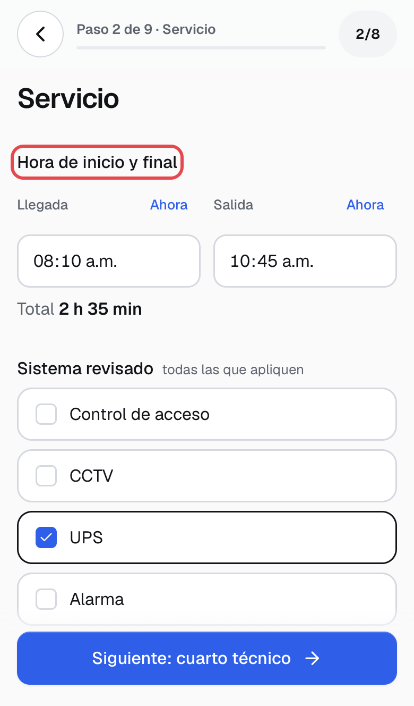

- **Tablas de medidas** (por ejemplo voltajes y corrientes por fase): cada fila es una medida y cada columna una fase (F1, F2, F3). Escribe cada casilla; las que no apliquen se dejan vacías.

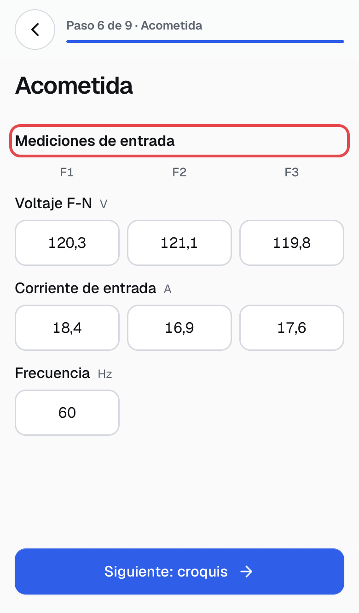

### 4.4 Datos obligatorios y «No se pudo obtener»

Los datos obligatorios dicen «obligatorio» al lado del nombre. Si tocas «Siguiente» y falta alguno, sale una hoja «Faltan [N] datos en [paso]» con la lista. Puedes:

- tocar «Completar ahora», o
- tocar «Seguir y completar después» y volver antes de enviar.

![Hoja «Faltan [N] datos» con «Completar ahora»](capturas/tecnicos-11-faltan-datos.png)

Si un dato obligatorio **no se puede obtener** en el sitio (por ejemplo, la placa del equipo está borrada):

1. Toca «No se pudo obtener», debajo del dato. El dato queda bloqueado.
2. Escribe el «Motivo». Es obligatorio.

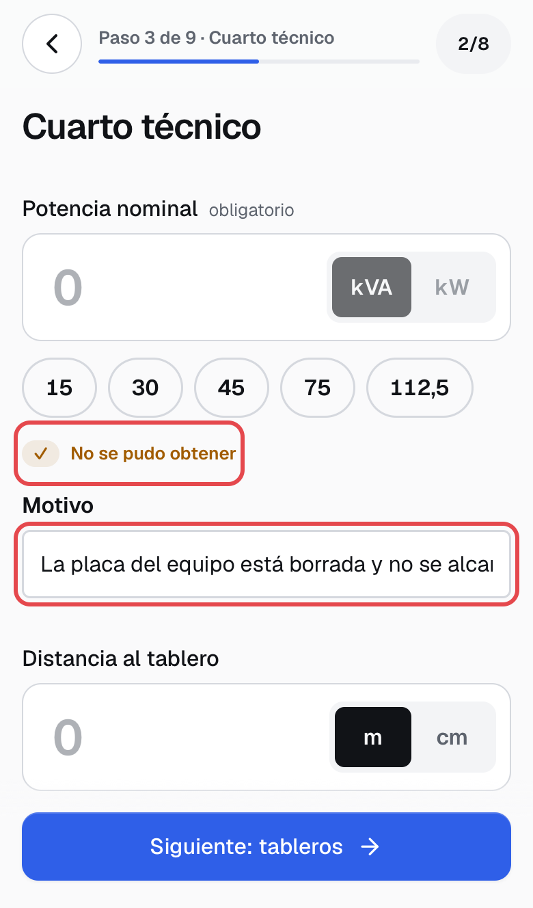

Si después sí lo obtienes, toca otra vez «No se pudo obtener» para quitar la marca y escribe el dato.

### 4.5 Fotos

1. Toca el recuadro de la foto. Cada recuadro dice qué foto va (por ejemplo «Placa», «Vista general»). Arriba a la derecha ves cuántas llevas («2 de 3»).
2. Mientras se guarda, dice «Guardando foto…». Cuando están todas, aparece «Tomar otra foto» por si necesitas más.
3. Toca una miniatura para verla grande.
4. Para borrarla, ábrela y toca «Eliminar». Aparece «Foto eliminada» con «Deshacer» por si te equivocaste.

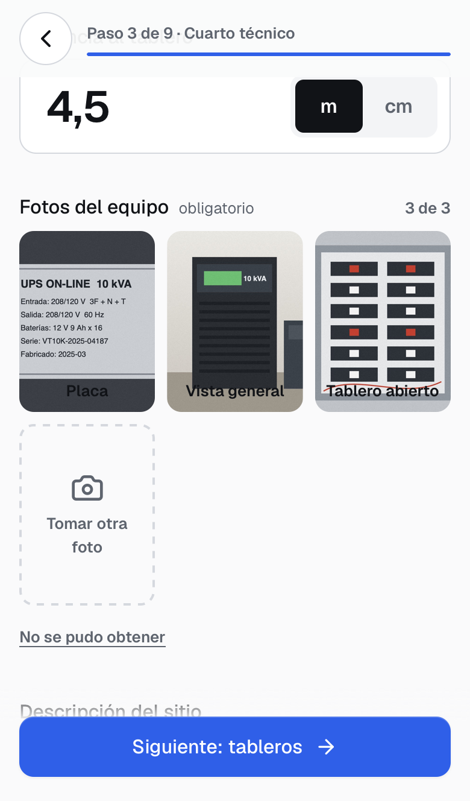

Si dice «No se pudo guardar la foto. Tómala de nuevo.», vuelve a tomarla.

### 4.6 Secciones que se repiten (tableros, pisos, equipos)

Algunas secciones se llenan una vez por cada cosa que revisas, por ejemplo una por tablero.

1. Toca «Agregar [tablero]». Aparece «Tablero 1».
2. Llena sus datos y fotos.
3. Abajo: «Siguiente: Tablero 2» para pasar al siguiente, «Volver a la lista», o «Listo, ver [tableros]» en el último.
4. Para cambiar el nombre (por ejemplo «Tablero principal») o quitarlo, toca el menú «⋯» y elige «Cambiar nombre» o «Quitar [tablero]». Si lo quitas por error, toca «Deshacer» en el aviso.

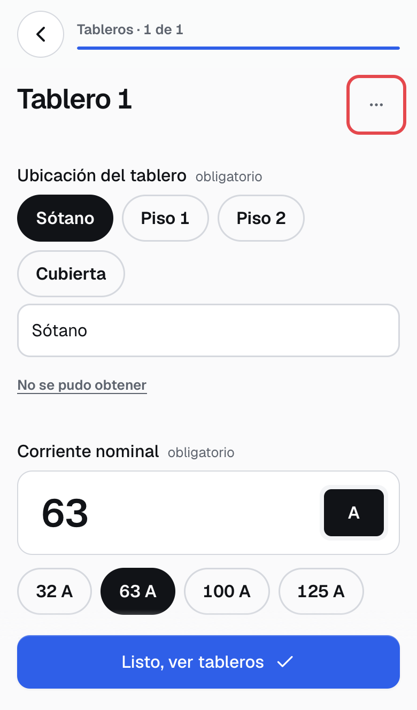

Si no aplica, deja la sección vacía y sigue. Hay formatos que piden un mínimo o permiten un máximo; la app te lo dice.

### 4.7 Croquis

1. Abre el paso del croquis. Si el croquis va junto con otros datos, toca «Dibujar boceto» (o «Editar boceto» si ya tiene algo).
2. Se abre la hoja cuadriculada a pantalla completa. Arriba está la barra de herramientas, con íconos:

| Herramienta | Ícono | Para qué |
|---|---|---|
| «Deshacer» / «Rehacer» | Flechas curvas | Quitar o volver a poner lo último. |
| «Trazo» | Lápiz | Dibujar a mano con el dedo o el lápiz. |
| «Cota» | Regla | Trazar una línea con su medida. Al soltar, escribe la medida (por ejemplo 4,50 m) y toca «Poner medida». |
| «Texto» | T | Toca la hoja, escribe y toca «Poner texto». |
| «Mover» | Cruz de flechas | Toca algo para elegirlo. Arrástralo, gíralo o cámbiale el tamaño. Tienes «Duplicar» y «Quitar». |
| «Borrador» | Borrador | Toca un trazo para borrarlo. |

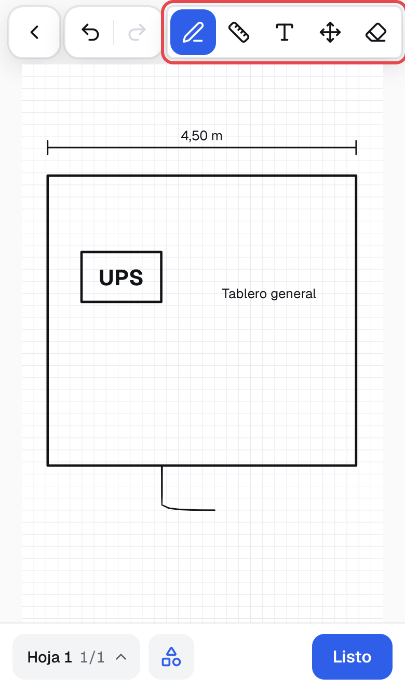

Trucos:

- **Formas rectas:** dibuja un rectángulo, una línea o un círculo y, al terminar, deja el dedo quieto medio segundo. Un anillo se llena y la forma queda recta.
- **Acercar:** con dos dedos acercas y mueves la hoja. Para volver a ver toda la hoja, toca el porcentaje del zoom.
- **Símbolos:** toca el botón de las figuras (abajo, junto a la hoja) para abrir «Símbolos». Busca, por ejemplo, «UPS» o «tom». El símbolo cae en el centro y queda elegido para moverlo. Los que usaste salen en «Recientes».
- **Varias hojas:** toca la pastilla de abajo («Hoja 1») para «Agregar hoja», «Cambiar nombre» o «Quitar esta hoja». También puedes deslizar dos dedos hacia la izquierda en la última hoja para agregar otra.

3. Toca «Listo» para volver al levantamiento. Cada cambio se guarda en el teléfono al momento.

### 4.8 Materiales

1. Toca «Buscar en el catálogo».
2. En «Agregar del catálogo», escribe el nombre o el código del material. Funciona sin señal.
   - «Los que más usas» muestra los que eliges seguido.
   - Toca «+ Agregar» en el material y ajusta la cantidad con los botones de más y menos. Abajo ves cuántos llevas («1 agregado»).
   - Toca «Ver materiales» para volver.

   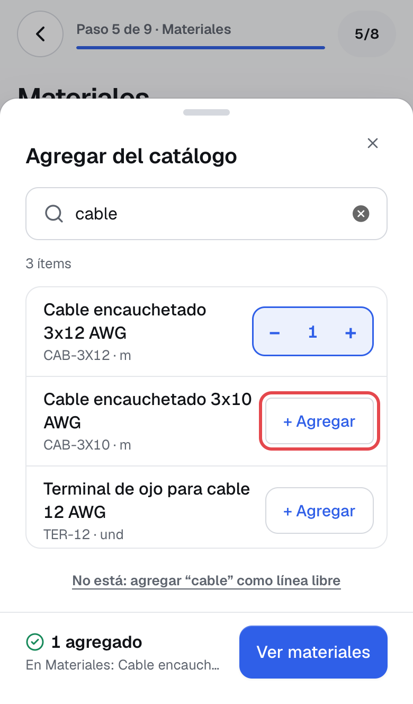

3. Si no está en el catálogo, toca «No está: agregar “[texto]” como línea libre», o en la pantalla del paso «No está en el catálogo: agregar línea libre». Escribe la descripción, la cantidad y elige la unidad.
4. Para dejar una aclaración, toca «Agregar nota» en la línea.
5. Para quitar una línea, baja su cantidad a cero. Si fue un error, toca «Deshacer».

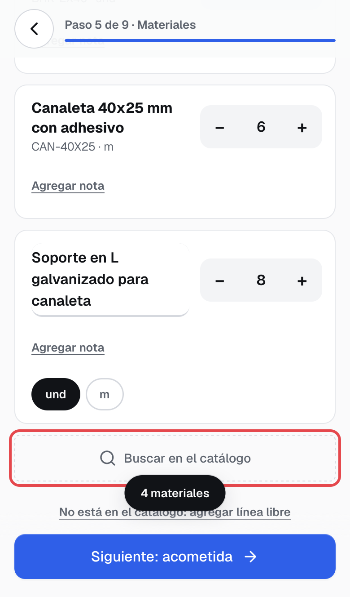

### 4.9 Firma de quien recibe la visita

1. En el paso de la firma, toca «Entregar el teléfono».
2. Entrega el teléfono a quien te recibió. Verá «Confirme la visita de [tu nombre]», el texto de la constancia con el cliente, el sitio y la fecha.
3. Esa persona escribe «Su nombre» (obligatorio) y su «Cargo (opcional)», firma con el dedo en el recuadro y toca «Firmar».
   - «Borrar» limpia el recuadro. «Cancelar» cierra sin firmar.

   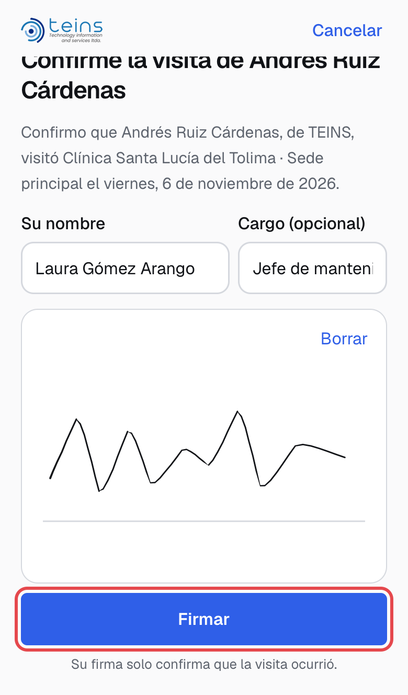

4. Al recibir el teléfono, verás la constancia con «Firmada hoy [hora]», la firma, el nombre y el cargo.

Si hay que repetirla, toca «Repetir» y confirma con «Volver a firmar».

### 4.10 Revisar y enviar

1. Cuando termines el último paso, toca «Revisar y enviar».
2. Verás «Revisa y envía»: cliente, sitio, formato, cuántas fotos, repeticiones y materiales llevas, y cada paso con lo que tiene. Lo que falta sale marcado. Toca una fila para ir a ese paso.

   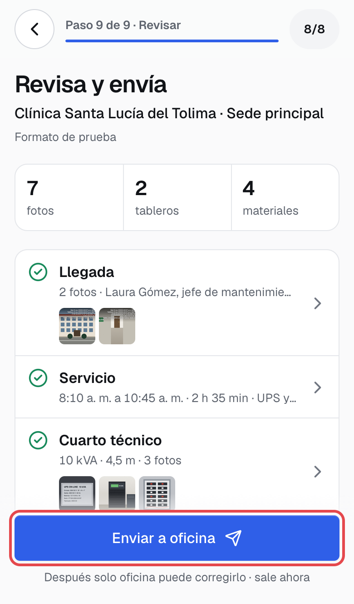

3. Toca «Enviar a oficina».
4. Lee la confirmación «¿Enviar a oficina?». Después de enviar ya no podrás editar este levantamiento: solo oficina puede corregirlo.
5. Toca «Enviar levantamiento».
6. La pantalla muestra el avance: «Guardado en el teléfono», «Fotos y dibujos · [N] de [Total]» y «Recibido en oficina». Puedes salir de esta pantalla: el envío sigue solo.
7. Toca «Ver la siguiente visita» o «Volver a mis visitas».

---

## 5. Trabajar sin señal

- **Todo se guarda en el teléfono.** Puedes capturar datos, fotos, croquis, materiales y firma sin señal. La franja dice «Sin señal · ... Puedes seguir.».
- **Enviar sin señal sí se puede.** La pantalla del envío dice «Esperando señal» y «Sin conexión: se enviará al recuperar señal».
- **Se envía solo** cuando vuelve la señal. No tienes que hacer nada. Puedes seguir con otra visita.
- Cuando termina de subir, verás «Recibido en oficina» y la franja dice «Todo subido».

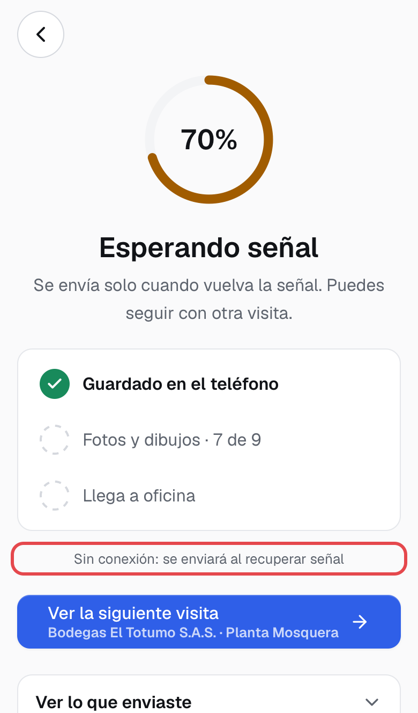

### Lo que nunca debes hacer con cosas sin enviar

Lo que no se ha enviado **solo existe en tu teléfono**. Si haces algo de esto, se pierde para siempre:

- Borrar la app TEINS de la pantalla de inicio.
- Borrar el historial o los datos de sitios web en Safari (Ajustes › Safari).
- Restablecer o cambiar el teléfono.

Antes de cualquiera de esas cosas, abre la app con señal y espera a que diga «Todo subido».

### Si pasas muchos días sin señal

Por seguridad, si el teléfono pasa demasiado tiempo sin conectarse, la captura se bloquea: verás «Pasó demasiado tiempo sin conexión y la captura quedó bloqueada por seguridad. Nada se borró: conéctate para seguir.». Conéctate un momento y sigue trabajando.

---

## 6. Después de enviar

### Estados de lo enviado

En «Enviados» cada levantamiento muestra su estado corto:

| Estado | Qué significa |
|---|---|
| «Por enviar» o «Se envía al tener señal» | Está en tu teléfono esperando señal. |
| «Verificando fotos» | Oficina está comprobando que las fotos llegaron completas. Espera. |
| «Recibido» | Llegó a oficina. |
| «En revisión» | Alguien de oficina lo está revisando. |
| «Revisado» | Oficina terminó de revisarlo. |
| «No se pudo enviar» | Oficina no pudo recibirlo. Sale arriba, en «Necesita atención». |
| «Actualiza la app» | Tu versión de la app ya no puede enviar. Ver [La app pide actualizar](#la-app-pide-actualizar). |

Los levantamientos revisados se quitan solos del teléfono un tiempo después; oficina conserva la copia.

### Si dice «No se pudo enviar»

Abre el levantamiento. Verás por qué no entró, por ejemplo «Oficina no pudo aceptar algunos datos.». Lo capturado sigue guardado en tu teléfono.

1. Avísale a oficina: ellos ven el error.
2. Cuando te digan que está resuelto, toca «Reintentar envío».
3. Si hay algo que corregir, toca «Volver a borrador para corregir» y confirma con «Volver a borrador». Lo editas y lo envías otra vez.

Esto solo pasa con algo que oficina **nunca recibió**. Lo que ya llegó a oficina no vuelve a tu teléfono para editar: si hay que corregirlo, lo corrige oficina.

### Conversaciones con oficina (chat)

Si oficina tiene una pregunta sobre un dato:

1. Te llega un aviso «Oficina · [Cliente]» y en el inicio, en «Necesita atención», sale «Oficina te escribió». El ícono de la app muestra un número.

   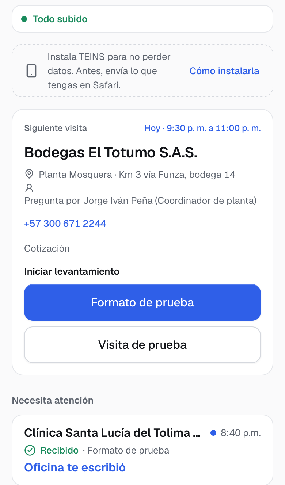

2. Toca la fila: se abre el chat con «Oficina». Cada mensaje muestra el dato del que pregunta (el paso, el nombre y el valor que enviaste).
3. Toca el mensaje que quieres responder (abajo dice «Respondiendo a Oficina»), escribe en el cuadro «Mensaje» y toca la flecha para enviar.
4. Debajo de tu mensaje verás «Enviado» y, cuando oficina lo lea, «Leído».

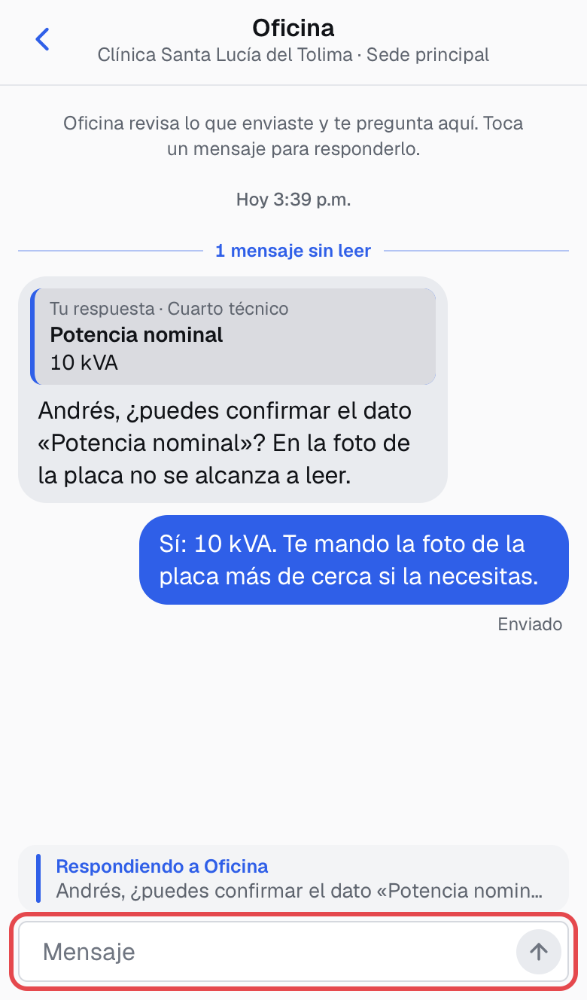

Sin señal, tu respuesta queda guardada con «Esperando señal…» y en el inicio dice «1 respuesta por enviar». Sale sola cuando vuelva la señal.

Cuando oficina marca el levantamiento como revisado, la conversación se cierra: verás «La conversación quedó cerrada». Si algo es urgente, llama a oficina.

### Terminar visita

Cuando una visita no tiene hora de fin, en la tarjeta aparece «Terminar visita» mientras está «En curso». Úsalo al irte del sitio para que oficina sepa que quedaste libre.

1. Toca «Terminar visita».
2. Lee la confirmación «¿Terminar la visita a [Cliente]?» y toca «Terminar visita».
3. Verás «Visita terminada: oficina ya te ve libre» o, sin señal, «Visita terminada: oficina lo sabrá cuando tengas señal».

Si te falta enviar algo de esa visita, lo sigues pudiendo enviar.

### Ver lo que enviaste

En una visita ya atendida, toca «Ver lo que enviaste» para ver el levantamiento tal como salió. Es solo de lectura.

---

## 7. Descartados: borrar y recuperar

Solo puedes descartar un levantamiento que **nunca enviaste**.

### Descartar

1. Abre el levantamiento y abre «El recorrido».
2. Al final de la lista, toca «Descartar levantamiento».
3. Lee la confirmación «¿Descartar este levantamiento?»: sale de Mis visitas, queda 30 días en Descartados y después se borra del teléfono con sus fotos. Oficina nunca lo recibió: no queda otra copia.
4. Toca «Descartar». Verás «Levantamiento descartado» con «Ver en Descartados».

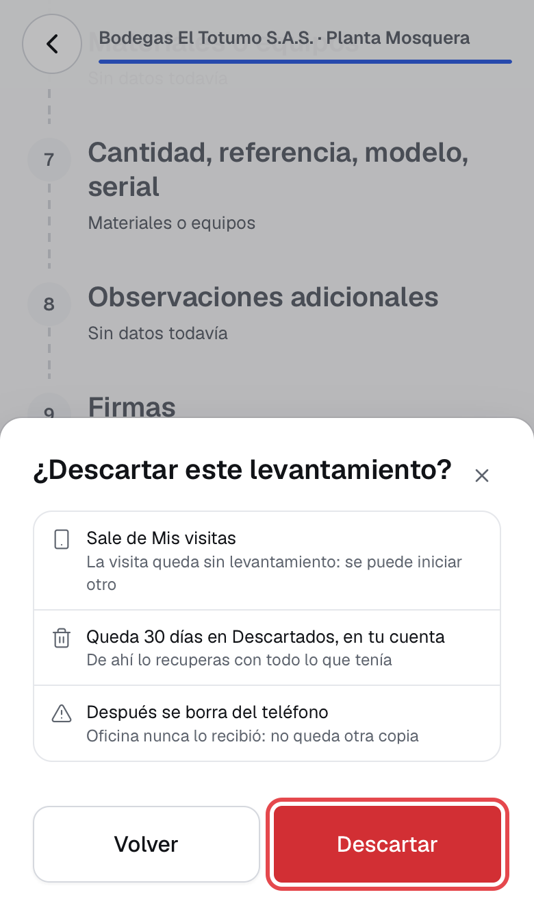

La visita queda sin levantamiento y puedes iniciar otro.

### Recuperar

1. Toca tu círculo de iniciales («Tu cuenta») y luego «Descartados».
2. Cada levantamiento dice cuándo se borra: «Se borra el [fecha]».
3. Toca «Recuperar». Verás «Levantamiento recuperado: sigue donde lo dejaste».

![«Descartados» con «Se borra el [fecha]» y «Recuperar»](capturas/tecnicos-24-descartados.png)

Si la visita ya tenía otro levantamiento, vuelve como «Levantamiento suelto» (sale en «Sin terminar»).

Lo descartado está **solo en este teléfono**. Pasados 30 días se borra y no se puede recuperar.

---

## 8. Problemas frecuentes

Cada problema dice primero lo que ves en la pantalla y después qué hacer.

### Envié y no llega a oficina

**Lo que ves:** la franja de arriba dice «Sin señal · 1 levantamiento espera para subir» o el envío se queda en «Esperando señal».

1. Busca señal o Wi-Fi.
2. Abre la app con señal y déjala abierta un momento. Lo pendiente sale enseguida.
3. Si dice «Inicia sesión para enviar», toca «Iniciar sesión» y entra. Lo capturado sigue en el teléfono.
4. Si dice «No se pudo enviar», mira [Si dice «No se pudo enviar»](#si-dice-no-se-pudo-enviar).
5. Para revisar que las fotos estén bien guardadas: «Tu cuenta» › «Diagnóstico del teléfono» › «Verificar fotos». Debe decir «Perdidas: 0».

### La foto de llegada sale sin ubicación

**Lo que ves:** «Sin permiso de ubicación: la foto sale sin coordenadas», o la franja de la foto sin coordenadas.

Revisa que la ubicación del teléfono esté activada (en el iPhone, Ajustes › Privacidad y seguridad › Localización) y, cuando TEINS la pida, toca **Permitir**. Espera «Ubicación lista» antes de la foto; si ya la tomaste, bórrala y tómala de nuevo. Si TEINS no vuelve a pedir el permiso, avísale a oficina.

### No me deja pasar al siguiente paso

**Lo que ves:** la hoja «Faltan [N] datos en [paso]».

Toca «Completar ahora» y llena los datos de la lista. Si de verdad no se pueden obtener, márcalos con «No se pudo obtener» y escribe el motivo. Si prefieres seguir, toca «Seguir y completar después»: tendrás que completarlos antes de enviar.

### No puedo escribir un dato

**Lo que ves:** el dato aparece bloqueado y debajo está marcado «No se pudo obtener».

Toca «No se pudo obtener» para quitar la marca y escribe el dato.

### Queda poco espacio en el teléfono

**Lo que ves:** en «Tu cuenta» › «Diagnóstico del teléfono», «Queda poco espacio en este teléfono».

- Si tienes levantamientos descartados, toca «Vaciar Descartados» y confirma. Se borran para siempre.
- Si no, libera espacio en el teléfono (fotos personales, videos, apps que no uses). **Nunca** borres TEINS ni los datos de Safari para liberar espacio.

Si en «Tu cuenta» sale «El teléfono no garantiza conservar los datos. Avísale a soporte antes de capturar.», avísale a oficina antes de seguir.

### Olvidé la contraseña

**Lo que ves:** «Usuario o contraseña incorrectos.» aunque el usuario está bien escrito.

Pídele a oficina que la restablezca. Te darán una contraseña temporal y, al entrar, la app te pedirá crear una nueva.

Para cambiar tu contraseña cuando quieras: «Tu cuenta» › «Cambiar contraseña». Necesita señal.

### Perdí el teléfono o me lo robaron

Avísale a oficina **de inmediato**. Oficina cierra tu acceso y, cuando ese teléfono se conecte, la app borra tus datos de él. Lo que no habías enviado desde ese teléfono se pierde.

En un teléfono nuevo, instala la app y entra con tu usuario (sección 2).

### La app pide actualizar

- Si sale «Hay una versión nueva de la app. Tus levantamientos se conservan.», toca «Actualizar la app». No se pierde nada.
- Si sale «Esta versión de la app ya no puede enviar. Actualízala para enviar lo pendiente; nada se pierde.», actualiza con señal y lo pendiente se envía.
- Si sale «Faltan los formatos en este teléfono. Conéctate un momento para descargarlos.», abre la app con señal.

### «Demasiados intentos. Espera un minuto e intenta de nuevo.»

Pasa cuando muchas personas entran al mismo tiempo desde el mismo Wi-Fi (por ejemplo, en la oficina al empezar el día). Espera un minuto y vuelve a intentar.

### «Usuario o contraseña incorrectos.»

Revisa mayúsculas y que no haya espacios. Si sigue, pídele a oficina que revise tu usuario.

### «Tu sesión venció.»

Toca «Iniciar sesión» y entra de nuevo. Lo capturado sigue en el teléfono.

### No me aparece la visita

**Lo que ves:** «Sin visitas asignadas» o «No tienes visitas pendientes», y oficina dice que ya te la asignó.

Abre la app con señal y espera un momento: las visitas llegan al sincronizar. Si es de otro día, está en «Después» con «Podrás iniciarla [día]». Si sigue sin aparecer, pídele a oficina que revise a quién se la asignó.

### No me llegan los avisos

Abre «Tu cuenta» › «Diagnóstico del teléfono» y mira «Avisos».

- «Bloqueados»: en el iPhone ve a Ajustes › Notificaciones › TEINS › Permitir notificaciones.
- «Sin activar»: en el inicio toca «Activar avisos».
- «Solo con la app instalada»: abre TEINS desde el ícono, no desde Safari.

### Algo falló en la pantalla

**Lo que ves:** «Algo falló al mostrar esta pantalla.»

Toca «Volver a cargar». Lo capturado sigue en el teléfono.

### Comparto el teléfono con otro técnico

Cada uno entra con su usuario. Para cambiar, «Tu cuenta» › «Cerrar sesión». Si tienes cosas sin enviar, la app te avisa: se quedan en el teléfono y se envían cuando vuelvas a iniciar sesión.

---

## 9. A quién pedir ayuda

Para todo, habla con **oficina**:

- usuario nuevo, contraseña olvidada o llave de acceso que no sirve,
- visitas que no te aparecen o datos de la visita que están mal,
- algo que no se pudo enviar,
- teléfono perdido o robado.

Cuando llames, ten a mano: tu usuario, el cliente y el sitio de la visita, y el texto exacto que te muestra la pantalla. En «Tu cuenta», al final, está la versión de la app («TEINS · versión [N]»): dísela también.

---

## 10. Glosario

| Palabra | Qué quiere decir |
|---|---|
| **Visita** | Lo que oficina te programa: un cliente, un sitio, un día y, si aplica, una hora. |
| **Levantamiento** | Lo que capturas en una visita: datos, fotos, croquis, materiales y firma. Una visita lleva uno por técnico. |
| **Formato** | La lista de pasos y datos que pide un tipo de visita (por ejemplo, servicio de UPS o visita técnica). Lo define TEINS. |
| **Paso** | Cada sección del formato. «El recorrido» los muestra todos. |
| **Borrador** | Un levantamiento empezado y sin enviar. Solo existe en tu teléfono. |
| **Enviar** | Pasar el levantamiento a oficina. Después ya no lo editas tú. |
| **Sin señal** | Sin conexión. Puedes seguir trabajando: lo pendiente sale solo al volver la señal. |
| **Revisar** | Lo que hace oficina con lo que enviaste: lo lee, corrige si hace falta y te pregunta por chat. |
| **Revisado** | Oficina terminó. El levantamiento ya puede ir en el informe y la conversación se cierra. |
| **Informe** | El documento PDF que recibe el cliente, armado por oficina con los levantamientos revisados. |
| **Publicar** | Lo que hace oficina para entregar una versión del informe al cliente. |
| **Versión** | Cada entrega del informe. Una versión publicada no cambia: para corregir, oficina publica otra. |
| **Portal** | La página donde el cliente descarga sus informes. Tú no entras ahí. |
| **Constancia** | La firma de quien te recibió, que confirma que la visita ocurrió. |
| **Descartados** | Donde quedan 30 días los levantamientos que borraste sin enviar. |
| **Línea libre** | Un material que no está en el catálogo y escribes a mano. |
